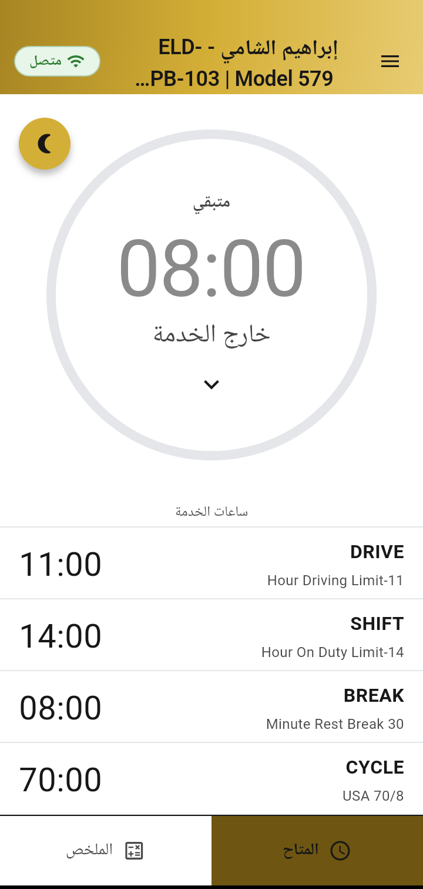
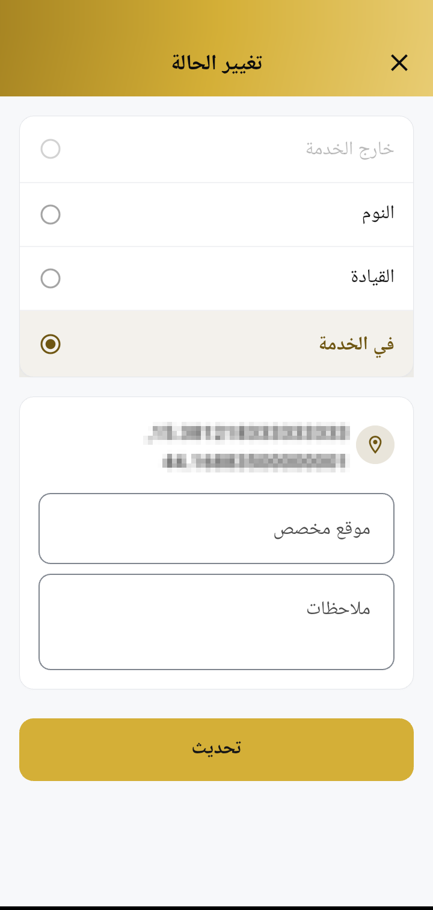
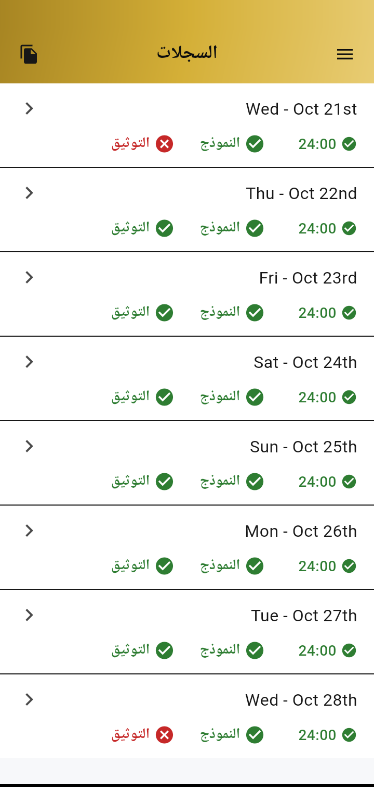
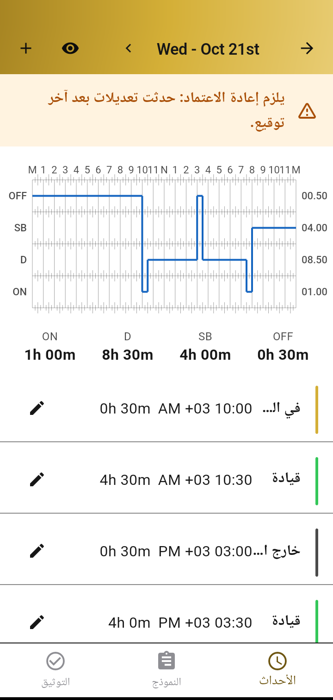
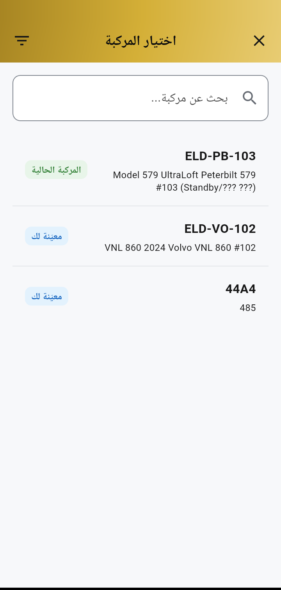
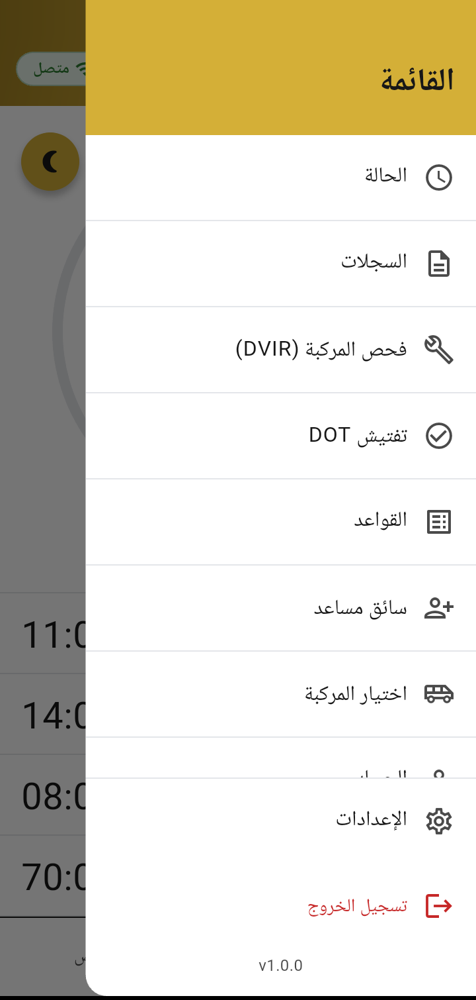

# Golden Feather ELD

[](https://flutter.dev)
[](https://dart.dev)
[](#platforms)
[](pubspec.yaml)
[](https://github.com/AmeenAlslahy/golden_feather_eld/actions/workflows/verify.yml)

A Flutter **Electronic Logging Device (ELD)** app for commercial drivers. It records hours of service, duty-status changes, daily logs and certifications, DVIR vehicle inspections, DOT inspections, vehicle/ELD connectivity and GPS tracking — and keeps accepting data when the network drops.

The app ships in **Arabic, English and Spanish**, with full RTL support for Arabic, and offers light and dark themes built on a single, contrast-tested design system.

---

## Screenshots

<p align="center">
  
  
  
</p>
<p align="center">
  
  
  
</p>

<sub>Captured on a physical Android device. The interface is shown in Arabic; the app also ships in English and Spanish. Location coordinates are blurred for privacy.</sub>

---

## Features

**Hours of Service (HOS)**

- Live dashboard with remaining-time circle and DRIVE / SHIFT / BREAK / CYCLE limits
- Duty-status change (Off Duty, Sleeper, Driving, On Duty) with validation: location required, notes required where mandated, and a guard that blocks non-driving statuses while the vehicle is moving
- Personal Conveyance and Yard Move support, enabled per carrier rules
- Available / Recap tabs, with server-driven indicator values

**Logs & compliance**

- Daily logs list with per-day certification state
- 24-hour duty graph, event list and per-event editing
- Log certification and recertification
- Suggested events and unidentified events with claim/reject and annotation
- Audit trail

**Inspections**

- DVIR: inspection list, inspection form with defects and driver signature
- DOT inspection mode with log transfer (send logs)

**Vehicle & device**

- Vehicle selection (assigned fleet / company fleet browsing) and ELD connection by device identifier
- Connection status indicator, session confirmation and hardware alerts
- GPS tracking and location capture for duty-status events

**Platform**

- Offline-first: local persistence plus a sync queue; data is accepted offline and synced when connectivity returns
- Co-driver management and driver switching
- Push notifications (Firebase Messaging) and crash reporting (Firebase Crashlytics)
- Localization: Arabic, English, Spanish (full RTL layout)
- Light / dark theme with semantic success, warning, error and info colors
- Runtime settings: interface language, theme mode and server URL

---

## Tech Stack

| Layer | Choice |
|---|---|
| Framework | Flutter (Dart) |
| State management | Riverpod 2 (`flutter_riverpod`, `riverpod_annotation`) |
| Routing | GoRouter |
| HTTP client | Dio + `connectivity_plus` |
| Local storage | Hive, `shared_preferences`, `flutter_secure_storage`, `sqflite` |
| Location | `geolocator` |
| Media | `signature` (DVIR signatures), `share_plus` |
| Backend services | Firebase Core, Crashlytics, Messaging |
| Config | `flutter_dotenv` (`.env`) |
| Code generation | Freezed, JSON Serializable, Riverpod Generator, `build_runner` |
| Quality | `flutter_lints`, `very_good_analysis`, `mocktail`, architecture guard tests |

---

## Prerequisites

- **Flutter 3.32.0 or newer** (CI pins 3.41.9) and Dart **3.8+**
- Android Studio with the Android SDK — the app compiles against **compileSdk 36**
- Xcode for iOS builds (macOS only)
- A reachable Golden Feather backend (see [API configuration](#api-configuration))
- An emulator or a physical device

Check your setup with:

```bash
flutter doctor
flutter devices
```

---

## Installation & Run

```bash
# 1. Clone
git clone https://github.com/AmeenAlslahy/golden_feather_eld.git
cd golden_feather_eld

# 2. Install dependencies
flutter pub get

# 3. Environment file (Windows: copy .env.example .env)
cp .env.example .env

# 4. Generate Freezed / JSON / Riverpod code
dart run build_runner build --delete-conflicting-outputs

# 5. Run
flutter run
```

Run on a specific device:

```bash
flutter run -d <device-id>
```

### Platforms

| Target | Folder | Status |
|---|---|---|
| Android | `android/` | Primary target — used for release APKs |
| iOS | `ios/` | Project scaffolding present |
| Web | `web/` | Project scaffolding present |
| Windows | `windows/` | Project scaffolding present |

---

## API Configuration

The app talks to a REST backend over HTTPS. The base URL is the **only** required environment value:

```dotenv
# .env
TRACCAR_ENVIRONMENT=production
API_BASE_URL=https://snsoft.cloud
```

Rules that matter:

- `API_BASE_URL` must **not** include `/api` — the client appends it, so a trailing `/api` produces `/api/api`.
- The base URL can also be changed at runtime from **Settings → Server URL**, without rebuilding.
- Authentication is session-based: the driver signs in with email and password, and the session token is stored in secure storage.
- No API keys or credentials are stored in the repository. `.env` is tracked and contains the base URL only; use `.env.local` (ignored) for local overrides.

Endpoints are grouped in `lib/backend/http/eld_endpoints.dart`:

| Group | Example paths |
|---|---|
| Session / auth | `/api/session`, `/api/eld/sessions/{driverId}`, `/api/eld/sessions/connect` |
| HOS | `/api/eld/hos/dashboard`, `/api/eld/hos/status`, `/api/eld/hos/recap` |
| Logs | `/api/eld/daily-logs`, `/api/eld/daily-logs/{id}/events`, `/api/eld/daily-logs/{id}/certify` |
| Rules | `/api/eld/driver-rules`, `/api/eld/driver-rules/{driverId}` |
| Tracking | `/api/positions`, `/api/devices`, `/api/events` |

---

## Project Structure

```text
lib/
├── main.dart              # Entry point
├── app.dart               # App widget, theme and providers wiring
├── routes.dart            # Router assembly
├── app/                   # Bootstrap, background services, DI
├── backend/               # HTTP client, endpoint map, backend contracts
├── core/                  # Shared infrastructure
│   ├── theme/             # Design tokens: colors, typography, spacing, styles
│   ├── widgets/           # Reusable UI (AppButton, AppFeedback, AppTextField, ...)
│   ├── network/           # ApiClient, ApiConfig, interceptors
│   ├── storage/           # Hive / secure storage / preferences adapters
│   ├── services/          # Location, tracking, notifications, sync helpers
│   └── utils/  extensions/  config/  session/  time/
├── domain/                # Shared domain entities
├── features/              # Feature-first modules
│   ├── auth/              # Splash, login, password reset
│   ├── vehicle/           # Vehicle selection
│   ├── connection/        # ELD connection, diagnostics, hardware alerts
│   ├── hos/               # Duty status, dashboard, rules engine
│   ├── logs/              # Daily logs, events, certification, audit trail
│   ├── dvir/              # DVIR inspections
│   ├── inspection/        # DOT inspection and log transfer
│   ├── codriver/  tracking/  sync/
│   └── account/  settings/  about/  onboarding/  permissions/
└── l10n/                  # Generated localizations (ar / en / es)

test/                      # Unit, widget, architecture guard and contrast tests
screenshots/               # Images used in this README
```

Each feature follows the same layout: `data/` (repositories, data sources), `domain/` (entities, engines, repository contracts) and `presentation/` (pages, widgets, providers).

---

## Building a Release APK

```bash
flutter build apk --release --split-per-abi
```

Split builds produce one APK per architecture under `build/app/outputs/flutter-apk/`:

| Artifact | ABI | Approx. size |
|---|---|---|
| `app-arm64-v8a-release.apk` | 64-bit ARM (most modern phones) | ~25 MB |
| `app-armeabi-v7a-release.apk` | 32-bit ARM | ~23 MB |
| `app-x86_64-release.apk` | x86_64 emulators | ~26 MB |

Use `--split-per-abi` for distribution. A universal APK bundles every ABI and is roughly **2.5–3× larger**.

Release signing reads `android/key.properties` (not committed). When that file is absent, the build falls back to debug signing — installable for testing, but **not** suitable for Google Play.

---

## Testing & Quality Gates

```bash
flutter analyze
flutter test
```

The test suite covers domain engines, repositories, providers, widget behavior and two cross-cutting guard suites:

- **Architecture guards** — enforce that feature code uses design-system tokens instead of raw colors, inline `TextStyle`s or numeric sizes.
- **Contrast budget tests** — enforce WCAG AA ratios for semantic text colors, solid feedback fills and interactive field borders in both light and dark themes.

CI (`.github/workflows/verify.yml`) runs on every push and pull request: format check, analyze, `flutter test --coverage`, and a clean-clone debug APK build.

---

## Troubleshooting

| Symptom | Cause / Fix |
|---|---|
| `SocketException`, timeouts, or `404` on API calls | Check `API_BASE_URL` (no `/api` suffix) and that the backend is reachable from the device |
| `401 Unauthorized` | The session expired — sign in again |
| Login works but the dashboard stays empty | The backend returned no data for the signed-in driver; verify the driver is assigned to a vehicle |
| Duty status cannot be changed | Non-driving statuses are blocked while the vehicle is moving, and a location is always required |
| "Kotlin daemon" error during the first Android build | Transient Gradle/Kotlin issue on Windows — re-run the build |
| Release APK installs but Play Console rejects it | `android/key.properties` is missing, so the APK was signed with the debug key |
| Arabic text renders LTR | Arabic needs RTL layout: switch the interface language to Arabic from **Settings → Interface language**. The app defaults to English on first launch |

---

## Contributing

1. Fork the repository and create a branch: `git checkout -b feature/my-change`
2. Follow the existing feature-first structure and use design-system tokens (no raw colors or inline text styles)
3. Run the gates before pushing:

```bash
dart format .
flutter analyze
flutter test
```

4. Open a pull request describing the change and the screens affected.

---

## License

No license is declared in this repository. If the app is intended for public or commercial distribution, add an appropriate license (for example MIT or Apache-2.0) and reference it here.

---

## Contact

- Repository: [github.com/AmeenAlslahy/golden_feather_eld](https://github.com/AmeenAlslahy/golden_feather_eld)
- Questions, bug reports and feature requests: open an issue in this repository.
