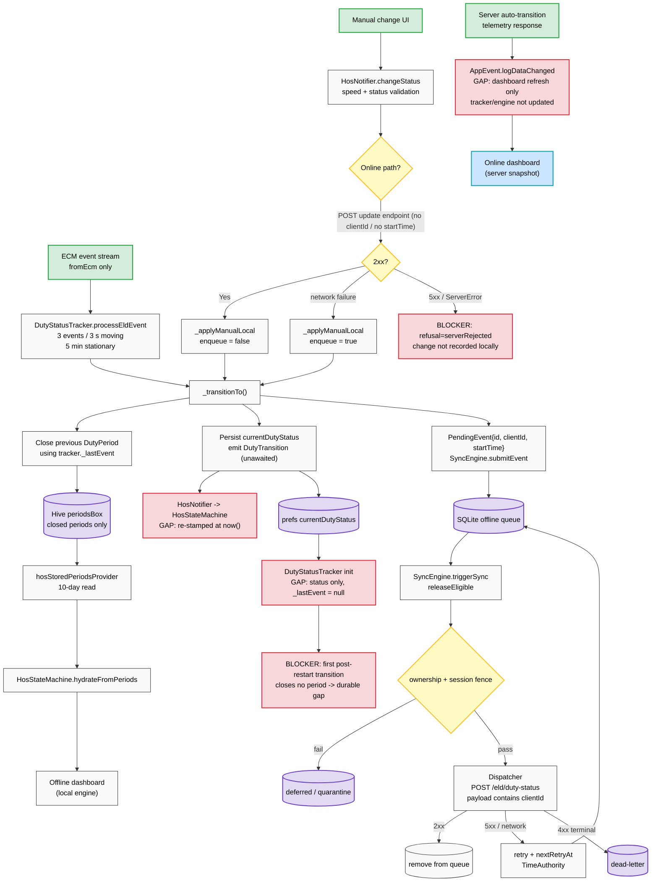

# Duty Event Lifecycle & Reconciliation Map

**Type:** as-built lifecycle audit / design prerequisite. **No production code was modified.**
**Repository:** `golden_feather_eld`, branch `version2`, working tree 2026-10-20.
**Purpose:** one end-to-end map of how a duty-status event is created, validated, persisted,
queued, synchronized, recovered, and displayed — and where it can be lost, duplicated, or
diverge between local and server state. This map is the basis for Phase 1 fixes and regression
tests; no refactor should start before it is agreed.

---

## 1. Lifecycle map (single diagram)



---

## 2. Stage contract (as built)

| Stage | Code | Durable artifact | What must hold |
|---|---|---|---|
| S0 Origin | `change_status_page` → `change_status_provider`; `eld_events_provider`; `tracking_orchestrator` | none | Every transition has exactly one origin and one event id. |
| S1 Validate | `hos_provider.dart` `HosNotifier.changeStatus`; `duty_status_tracker.dart` `processEldEvent` | none | Validation uses hydrated, trusted state; no transition on placeholder state. |
| S2 Commit local | `duty_status_tracker.dart` `_transitionTo` / `_persistTransition` | `periodsBox`, prefs, SQLite queue | Event is durable before the UI/engine acknowledges it. |
| S3 Enqueue | `_stampedDutyEvent` → `SyncEngine.submitEvent` | `PendingEvent{id, clientId, startTime, origin}` | Stable client id and immutable event time survive retries and restarts. |
| S4 Sync | `SyncEngine.triggerSync` → `TraccarRemoteEventDispatcher._dispatchDutyStatus` | queue states: pending / deferred / quarantine / dead-letter | Idempotent retry; no evidence loss; ownership fence. |
| S5 Recover | `hosStoredPeriodsProvider` → `HosStateMachine.hydrateFromPeriods`; `DutyStatusTracker._initStationaryState` | derived from S2 artifacts | Reconstructed state equals pre-restart state for every duty status. |
| S6 Present | `status_dashboard_providers` (server) vs `hos_provider` / offline dashboard (local) | none | One displayed truth, or an explicit “pending sync” marker. |

**Current event identity:** queue events carry a client UUID as `clientId`
(`duty_status_tracker.dart` `_stampedDutyEvent`), but the OpenAPI schema
`CreateDutyStatusRequest` does not document it, and the online endpoint
`UpdateStatusRequest` has neither `clientId` nor `startTime`.

---

## 3. Observed divergences

| ID | Finding | Evidence | Severity / gate |
|---|---|---|---|
| D1 | Restart loses the open duty segment: tracker restores status only, not the event that started it; first post-restart transition closes no period | `_initStationaryState`; `_transitionTo` period closure guarded by `_lastEvent` | P0 — blocks release |
| D2 | Local commit is fire-and-forget: `_transitionTo` emits the transition and returns before prefs/queue/period writes complete | `unawaited(_persistTransition(...))` | P0 — process kill can lose the event |
| D3 | Manual change during server 5xx is refused (`serverRejected`) instead of recorded locally | `submitManualChange` offline classification | P0 — blocks release |
| D4 | Same action has two representations: online POST has no event id/time; offline queue event has both, on a different endpoint | `updateDutyStatus` vs `_dispatchDutyStatus` | P0 — duplicate risk after lost response |
| D5 | Hydration is not a gate: `HosNotifier` and `changeStatus` can act before `hosHydrationReadyProvider` completes | `hos_provider.dart` initialization; `status_dashboard_providers.dart` only gates offline build | P0 — blocks release |
| D6 | Server auto-transition from telemetry is not ingested as an event; only a dashboard refresh is fired | `tracking_orchestrator` `transitionedToDriving` branch | P0/P1 — local/server split brain |
| D7 | Fabricated recap values (`availableTomorrow: 8h`, zero days) are served when authoritative data is missing | `status_dashboard_repository_impl._synthesizeRecap` | P0 — misleading regulatory display |
| D8 | Moving guard only logs and proceeds at tracker level | `_applyManualLocal` | P1 |
| D9 | Tracker transition is re-stamped with `now()` in the state machine, not the original event time | `hos_provider.dart` listener → `manualTransition` | P1 |
| D10 | Violation logging runs on every GPS pulse; `logViolation` scans the whole audit box per call | `hos_provider.dart` `_processAndLogViolations`; `hos_audit_repository_impl` | P1 |
| D11 | Dead/misleading paths: unused `submitEventAndReport` (removes on any `Left`), fully commented backend stubs, dual domain roots | see audit report | P2 |

---

## 4. Target lifecycle contract (proposal)

### 4.1 Event envelope (single schema for every origin)

```text
DutyEvent {
  eventId          // client UUID, stable across retries and restarts
  ownerDriverId    // proven owner, never inferred from the current session
  source           // manual | ecm | server
  status           // DRIVING | ON_DUTY | OFF_DUTY | SLEEPER | YARD_MOVE | PC
  eventTimeUtc     // trusted time when the transition occurred
  receivedAtUtc    // when this device learned about it
  payload          // location, odometer, engineHours, notes, origin
  syncState        // localOnly | queued | acked | rejected | superseded
  serverEventId    // filled on ack when the server returns it
}
```

### 4.2 Three layers, one authority per concern

1. **Recorded events (durable, append-only).** Written locally before any network call.
   This is the evidence layer. A process kill after this write loses nothing.
2. **Derived local state (periods + HOS calculation).** A pure reduction of recorded events
   plus trusted time. Only the reconciliation layer mutates it; UI and engine read it.
3. **Server view (dashboard snapshot).** Displayed as the authoritative online value, but
   never allowed to silently erase local evidence. Divergence is surfaced as “pending sync”.

### 4.3 Reconciliation rules

- **Rule 1 — Local-first commit.** A manual change is written to the journal and queue before
  the HTTP call; the HTTP call is a sync attempt, not the commit.
- **Rule 2 — One stable id.** `eventId`/`clientId` is generated once and reused on every retry.
- **Rule 3 — Outcome unknown is not rejection.** Timeout / 5xx means “unknown”; keep the event
  queued. Only business rejections (400/403/404/409/422) stop retries and require driver action.
- **Rule 4 — Nothing is deleted on failure.** Rejections mark the event `rejected` / dead-letter;
  they never silently remove evidence.
- **Rule 5 — Late and server events are ingested, not ignored.** Server auto-transitions arrive
  with a server id/time and are inserted by `eventTimeUtc`; duplicates are removed by
  `serverEventId` and `clientId`.
- **Rule 6 — Recompute on change.** Inserting a late event rebuilds affected periods and HOS
  limits; no incremental “patch the number” path.
- **Rule 7 — Hydration is explicit.** Until `HosInitializationStatus.ready`, no legal transition
  is accepted; incoming events are still journaled. Failure does not discard events.
- **Rule 8 — No fabricated regulatory values.** Missing recap/dashboard data renders
  “unavailable”, never a plausible number.
- **Rule 9 — Ownership at the event.** Queue and journal rows carry `ownerDriverId`; dispatch
  re-verifies it (existing fence is kept).

---

## 5. Backend contract decisions required

| ID | Decision | Why |
|---|---|---|
| B1 | Accept `clientId` (or `Idempotency-Key`) on `POST /eld/status/duty-status`; return the created duty event id and server event time | The online manual path currently has no idempotency key and no event time. |
| B2 | Confirm `POST /eld/duty-status` honors the already-sent `clientId`; document it in `CreateDutyStatusRequest` | The app sends it, the OpenAPI schema does not define it. |
| B3 | Return the created/transitioned duty event from the telemetry response, or expose `GET /eld/duty-status?since=` | A boolean `transitionedToDriving` cannot feed reconciliation. |
| B4 | Define 5xx semantics as “outcome unknown” and support retry with the same `clientId` | Prevents duplicate duty events when the server committed but the response was lost. |
| B5 | Decide whether manual changes should use one endpoint (`/eld/duty-status`) with `startTime` or keep two representations | Two endpoints produce two different event shapes for the same action. |

Recommended direction: **local-first journal + single `/eld/duty-status` contract** with
`clientId`, `startTime`, and a returned server event id. The dashboard then reconciles from the
server snapshot; it is no longer the write path.

---

## 6. Regression tests required (Phase 1 gate)

| # | Scenario | Required result |
|---|---|---|
| T1 | Restart while DRIVING | Period continues; no lost time; HOS matches pre-restart |
| T2 | Restart while ON_DUTY | Period continues with correct start time |
| T3 | Restart while OFF_DUTY / SLEEPER | Idle period preserved; no invented driving |
| T4 | Process kill immediately after transition | Event survives; period closes correctly on next start |
| T5 | HTTP 500 after server commit | Retry with same `clientId`; exactly one server event |
| T6 | Manual change before hydration completes | No transition on placeholder state; event journaled |
| T7 | Server auto-transition (telemetry) | Local event journal + derived state update; one canonical status |
| T8 | Offline manual change | Durable local record; queued retry; no server rejection |
| T9 | Weekly recap fetch failure | “Unavailable” state; no 8h/default values |
| T10 | Duplicate delivery / retry of same event | No duplicate period or duplicate server event |
| T11 | Driver switch with pending events | Events dispatch under original owner only |

---

## 7. Phase 1 scope (data protection only)

1. **P1.1 Durable journal + tracker rebuild.** Append-only duty-event store (same id as queue);
   rebuild `_lastEvent`, open period, and tracker state from it on startup.
2. **P1.2 Local-first manual change.** Journal + enqueue before HTTP; idempotent sync; distinguish
   business rejection from unknown outcome. Blocked on B1/B4.
3. **P1.3 Hydration gate.** Explicit `initializing / ready / failed`; block legal transitions and
   manual changes until ready; keep accepting events while failed.
4. **P1.4 Remove fabricated recap.** Render “unavailable” on fetch failure.
5. **P1.5 Tests T1–T11** as the release gate, plus a kill-during-write test.

Phase 2 (single source of truth and reconciliation) and Phase 3 (design cleanup) remain as
proposed in the review and are intentionally out of scope here.

---

## 8. Open points to confirm before implementation

1. Can the backend add `clientId` + server event id to both duty endpoints (B1/B2/B3)?
2. Is the telemetry auto-transition allowed to return the created duty event, or is a cursor GET
   preferred (B3)?
3. Should the durable journal reuse the existing SQLite queue database or a new Hive box?
4. Is `trusted time` always available at transition time, or must the journal support a
   `recordedAt` without `eventTimeUtc` (deferred stamping)?

---

## 9. Implementation decision record (Phase 1, 2026-10-20)

The two prerequisite decisions are now settled from code evidence. They are binding for P1.1/P1.3.

### 9.1 Journal storage and atomicity — DECIDED: same DB, one transaction

`SQLiteOfflineQueue` owns one `Database` for `offline_queue.db` (schema v4, static
`_database`). The journal is added as a table in **the same database** (schema v5) and is
written through the **same `Database` instance**:

```dart
await db.transaction((txn) async {
  await txn.insert('duty_event_journal', record,
      conflictAlgorithm: ConflictAlgorithm.ignore);
  if (syncEvent != null) {
    await txn.insert('pending_events', pendingRow(syncEvent),
        conflictAlgorithm: ConflictAlgorithm.replace);
  }
});
```

Consequences:

- **One identity:** `journal.event_id == PendingEvent.id == clientId`.
- **No partial commit:** a crash between the inserts rolls back both; a crash after commit
  leaves both. There is no window where the UI has an event the queue never received.
- **Order:** validate → journal+queue transaction → tracker public state + `DutyTransition`
  → engine/UI. Required persistence is awaited; `unawaited` is removed from this path.
- **Derived data is not the evidence:** closed `DutyPeriod` and `currentDutyStatus` are
  written after commit and may be rebuilt from the journal.
- **No deletion after sync:** the queue row is removed on ack, the journal row is retained
  (state becomes `acked` when the ack hook is added in P1.2; P1.1 retains `queued`).
- The queue remains the only dispatcher input; the journal never sends by itself.

### 9.2 Trusted-time-unavailable policy — DECIDED: journal evidence, never invent legal time

- A transition may be **applied** to HOS only with `TrustedTimeState.trusted`
  (`TrustedTimeAvailable`). `stale`, `invalid`, `unavailable`, and `uninitialized` are
  treated as “no legal time”.
- When trusted time is absent, the **intent is still journaled** (no event loss) with:
  `event_time_utc = NULL`, `received_at_utc = TimeAuthority.nowUtc()` (metadata only),
  `time_source = device`, `time_confidence = untrusted`, `sync_state = pendingReview`.
- A `pendingReview` row is **not applied** to derived HOS state and **not enqueued** for sync.
  When trusted time returns, the exact occurrence time cannot be reconstructed, so the
  event is surfaced to the driver/reviewer for correction; it is never silently stamped
  with the current time.
- `monotonic_ms` (`TrustedTimeProvider.monotonicElapsed`) is recorded for intra-session
  ordering only and is never interpreted as legal UTC.
- Legacy/no-journal paths keep the existing explicit `timeUnavailable` refusal.

### 9.3 Identity and ordering (P1.1 implementation contract)

| Layer | Field | Rule |
|---|---|---|
| Logical event | `event_id` | Client UUID created once per transition; unique in the journal. |
| Delivery | `delivery_id` | One row per local recording attempt; equal to `event_id` for P1.1. Retries update the queue row, they do not create journal rows. |
| Source | `source` | `manual` \| `ecm` \| `server`. |
| Server identity | `server_event_id` | `NULL` until the server echoes it (P1.2 / B1–B3). |
| Order | `event_time_utc`, `seq` | Replay sorts by legal time, then insertion sequence. `pendingReview` rows (`event_time_utc = NULL`) are not applied. |

Deduplication uses **identity only**. A server event without `clientId`/`server_event_id`
correlation gets its own `event_id`; the possible duplicate is surfaced, never merged by
`(status, timestamp)` alone.

### 9.4 P1.1 acceptance conditions

1. Append-only journal; no journal row is deleted on sync success, rejection, or replay.
2. On startup, derived state is rebuilt by replaying journal rows for their **stored
   `owner_driver_id`** — never inferred from the current session. Rows with no owner stay
   `pendingReview`.
3. Replay builds `_events`, `_lastEvent`, `_periods`, and `_currentStatus` deterministically;
   the open period survives restart (T1–T3).
4. Replaying the same journal twice produces identical state and no duplicate periods or
   transitions (T13).
5. A corrupted journal row is logged and retained; it is never deleted, and the tracker
   marks the journal as `corrupted` so incomplete HOS data is not presented as trusted (T14).
6. Journal+queue transaction failure leaves tracker state and transition stream unchanged;
   the transition is not emitted (T12).
7. Late/out-of-order events are ordered by `event_time_utc`, `seq`; affected periods are
   recomputed, not patched.

### 9.5 P1.3 acceptance conditions

1. Explicit state: `initializing` → `ready` or `failed`; failure is retryable.
2. The gate is enforced where the transition executes (`DutyStatusTracker`), not only in
   widgets/notifiers; ECM does not bypass it.
3. During `initializing`, manual changes are refused with `notReady`; ECM transition intents
   are journaled but not applied.
4. On `ready`, pending rows are replayed once (no double-apply) before the first legal
   transition is accepted.
5. `failed` still accepts and journals ECM evidence; it never permanently blocks recovery.

### 9.6 Additional regression tests (added to §6)

| # | Scenario | Required result |
|---|---|---|
| T12 | Journal+queue transaction fails | Neither row exists; tracker state unchanged; no `DutyTransition` emitted |
| T13 | Journal replayed twice / duplicate `event_id` | Identical derived state; no duplicate period/transition |
| T14 | Corrupted journal row | Row retained; corruption surfaced; incomplete HOS not shown as trusted |

### 9.7 Acceptance evidence and deferred items (2026-10-20)

P1.1/P1.3 acceptance evidence: 13 journal tracker tests in
`test/features/hos/domain/engine/tracking/duty_event_journal_tracker_test.dart`
(T1–T4, T6/T6b, T7, T8, T12/T12b, T13, T14) plus the dashboard hydration-retry test in
`test/features/hos/presentation/providers/status_dashboard_providers_test.dart`; full suite
green (1080 passed, 2 skipped).

Deferred with note (does not violate §9.4):

- **Replayed periods are not repopulated into the log store.** `_replayRecords` rebuilds
  `_periods` in memory only; `LogRepository.savePeriod` is still called exclusively on live
  transitions. After a restart, closed periods reconstructed from the journal exist for HOS
  computation but are not written back as log rows. Deferred to P1.2 / Phase 2, where server
  reconciliation supplies the authoritative period timeline.

Skipped tests in the full run (2) — pre-existing, outside P0 scope:

- `test/unit/core/utils/status_color_helper_test.dart` — placeholder test with an empty body;
  skipped pending the canonical ON-duty color product decision (BUG-001). Asserts no behavior
  today; UI-consistency concern only, not release-critical.
- `test/core/result/result_test.dart` (`mapValueAsync propagates error from mapper`) — skipped
  because mapper exceptions propagate by design and the test lacks the
  `expect(..., throwsA(...))` assertion needed to express that; needs a test rewrite, not a
  behavior fix. Unrelated to HOS/recap/journal paths.

Change-set separation (pre-merge review, 2026-10-20): every modified/untracked path in the
working tree was attributed hunk-by-hunk. No file mixes P0 changes with the concurrent Logs
feature; shared core files are single-effort scoped (`user_facing_message.dart` = P1.4;
`error_mapper.dart` + test = Logs/API-envelope effort per `audit/15_DAILY_LOG_API_SPEC_COMPARISON.md`
§D12). `android/build/` is an untracked generated artifact and must not be committed.
