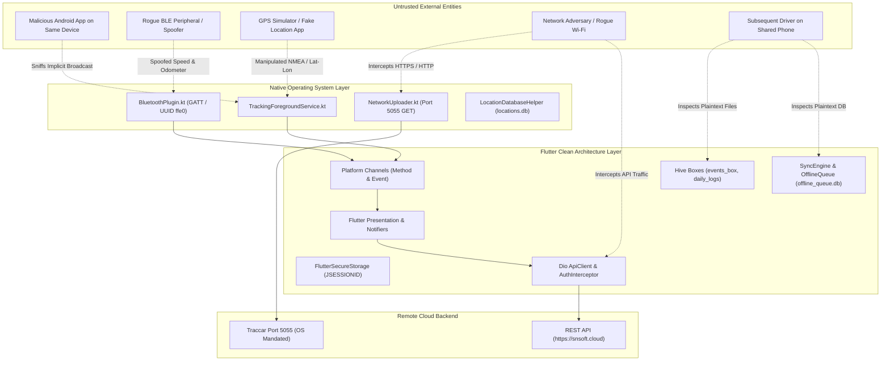

# Enterprise Mobile Application Deep Security Audit Report
**Project:** Golden Feather ELD  
**Target Platform:** Flutter Mobile Application (Android / iOS)  
**Architecture:** Clean Architecture with Riverpod & Offline Synchronization  
**Evaluation Standard:** OWASP Mobile Application Security Verification Standard (MASVS v2.0) & Threat Modeling (STRIDE)  
**Audit Scope:** Full Application Static Security Analysis, Architectural Audit, & Trust Boundary Verification  
**Auditor Mode:** Read-Only Non-Destructive Security Audit  
**Date:** October 2026  

---

## Table of Contents
1. [Executive Security Summary](#1-executive-security-summary)
2. [Overall Security Posture](#2-overall-security-posture)
3. [Audit Scope & Coverage](#3-audit-scope--coverage)
4. [Application Attack Surface Map](#4-application-attack-surface-map)
5. [STRIDE Threat Model](#5-stride-threat-model)
6. [Authentication Security Findings](#6-authentication-security-findings)
7. [Authorization Findings](#7-authorization-findings)
8. [Sensitive Data Storage Findings](#8-sensitive-data-storage-findings)
9. [Network & TLS Findings](#9-network--tls-findings)
10. [API Security Findings](#10-api-security-findings)
11. [Cryptographic Findings](#11-cryptographic-findings)
12. [Bluetooth Low Energy (BLE) Security Findings](#12-bluetooth-low-energy-ble-security-findings)
13. [GPS & Location Integrity Findings](#13-gps--location-integrity-findings)
14. [ELD & HOS Data Integrity Findings](#14-eld--hos-data-integrity-findings)
15. [Offline Synchronization Security](#15-offline-synchronization-security)
16. [Electronic Signature Security](#16-electronic-signature-security)
17. [Input Validation Findings](#17-input-validation-findings)
18. [Android Platform Security Findings](#18-android-platform-security-findings)
19. [iOS Platform Security Findings](#19-ios-platform-security-findings)
20. [Dependency Security & Supply Chain Findings](#20-dependency-security--supply-chain-findings)
21. [Logging & Information Disclosure](#21-logging--information-disclosure)
22. [Privacy & Data Protection](#22-privacy--data-protection)
23. [Secrets Scanning & Exposure Findings](#23-secrets-scanning--exposure-findings)
24. [Business Logic Vulnerabilities](#24-business-logic-vulnerabilities)
25. [Security Test Coverage Gaps](#25-security-test-coverage-gaps)
26. [Detailed Vulnerability Catalog](#26-detailed-vulnerability-catalog)
27. [False Positive Analysis](#27-false-positive-analysis)
28. [Risk Prioritization & Scoring](#28-risk-prioritization--scoring)
29. [Security Remediation Roadmap](#29-security-remediation-roadmap)
30. [Recommended Penetration Tests](#30-recommended-penetration-tests)
31. [Final Security Assessment & Sign-Off](#31-final-security-assessment--sign-off)

---

## 1. Executive Security Summary

An exhaustive, evidence-based security audit of the **Golden Feather ELD** mobile application was conducted. The application is an enterprise-grade electronic logging device (ELD) system for commercial motor vehicle drivers subject to FMCSA 49 CFR Part 395 regulations, built using Flutter, Dart, Riverpod, Dio, Hive, SQLite, and custom native platform channels (Android/iOS).

The primary objective of this audit was to rigorously inspect the codebase for security flaws, privacy leaks, authorization weaknesses, cryptographic deficits, and compliance data tampering risks without modifying application source code.

### Summary of Key Findings:
- **Total Security Findings Identified:** 11 distinct findings across 8 security domains.
- **Critical Severity:** 0
- **High Severity:** 3 (Unrestricted Android Broadcast Leaking Real-Time GPS, Plaintext Local Storage of Compliance Records & Draft Signatures, and Unauthenticated/Unbonded BLE Peripheral Connection).
- **Medium Severity:** 4 (Incomplete Session/Cache Cleanup on Logout, Lack of Cryptographic Binding in Electronic Signatures, Missing TLS Certificate Pinning, and Offline Monotonic Time Manipulation).
- **Low / Informational Severity:** 4 (Real-Time GPS Coordinates Logged in Android Logcat, Missing `FLAG_SECURE` Screen Shielding, Production `.env` Packaged into Assets, Exported BootReceiver Missing Permission).

```
   ┌─────────────────────────────────────────────────────────────┐
   │                  Vulnerability Severity Breakdown           │
   ├──────────────────┬──────┬───────────────────────────────────┤
   │ Critical (P0)    │  0   │ None identified                   │
   │ High (P1)        │  3   │ SEC-ANDROID-001, SEC-STORAGE-001, │
   │                  │      │ SEC-BLE-001                       │
   │ Medium (P2)      │  4   │ SEC-STORAGE-002, SEC-SIGN-001,    │
   │                  │      │ SEC-NET-001, SEC-TIME-001         │
   │ Low / Info (P3)  │  4   │ SEC-LOG-001, SEC-ANDROID-002,     │
   │                  │      │ SEC-CONF-001, SEC-ANDROID-003     │
   └──────────────────┴──────┴───────────────────────────────────┘
```

The application demonstrates strong architectural hygiene in its Riverpod state isolation, `SessionEpoch` request tagging, and HTTP dispatch fence enforcing driver ownership (`OwnerMismatchSignal`). However, critical weaknesses exist at the device OS boundary (implicit Intent broadcasting and plaintext Hive/SQLite storage) and hardware interface boundary (BLE without cryptographic pairing or mutual authentication).

---

## 2. Overall Security Posture

The application adheres strictly to Clean Architecture boundaries:
`Presentation (Widgets/Notifiers) -> Domain (Use Cases/Entities) -> Data (Repositories/DataSources) -> Core Services / Platform Channels`.

### Strengths:
1. **Request Identity Isolation:** The application features an innovative `SessionEpoch` and `credentialGeneration` architecture in [`AuthInterceptor`](file:///d:/Flutter%20projects/golden_feather_eld/lib/backend/http/interceptors/auth_interceptor.dart#L21-L140) and [`AuthNotifier`](file:///d:/Flutter%20projects/golden_feather_eld/lib/features/auth/presentation/providers/auth_state_provider.dart#L87-L140) that systematically prevents stale 401s from terminating fresh sessions and ensures atomic credential updates.
2. **Offline Dispatch Fencing:** The offline synchronization pipeline ([`TraccarRemoteEventDispatcher`](file:///d:/Flutter%20projects/golden_feather_eld/lib/features/sync/data/repositories/traccar_remote_event_dispatcher.dart#L67-L125)) verifies `EventOwnership` at HTTP dispatch time. Any event whose recorded driver ID does not match the active session driver is quarantined rather than submitted under the wrong identity.
3. **Driver App Scope Enforcement:** The codebase restricts UI and network operations to authenticated driver workflows, rejecting Fleet Manager, Administrator, or Mechanic management endpoints.
4. **Android Backup Disabled:** Android Manifest explicitly disables standard OS backups (`android:allowBackup="false"`).

### Architectural Weaknesses:
1. **Trust in Device Local Filesystem:** Hive database boxes ([`LocalDatabaseService`](file:///d:/Flutter%20projects/golden_feather_eld/lib/core/services/local_database_service.dart#L10-L40)) and SQLite databases ([`sqlite_offline_queue.dart`](file:///d:/Flutter%20projects/golden_feather_eld/lib/features/sync/data/repositories/sqlite_offline_queue.dart#L109-L145)) store sensitive HOS compliance logs, GPS tracks, and driver signatures in unencrypted plaintext on disk.
2. **Unconfined OS IPC Communication:** Native Android [`TrackingForegroundService.kt`](file:///d:/Flutter%20projects/golden_feather_eld/android/app/src/main/kotlin/com/goldenfeather/eld/TrackingForegroundService.kt#L182) broadcasts real-time GPS coordinates via an unrestricted implicit `sendBroadcast(intent)`.
3. **Absence of Peripheral Mutual Authentication:** Native Android [`BluetoothPlugin.kt`](file:///d:/Flutter%20projects/golden_feather_eld/android/app/src/main/kotlin/com/goldenfeather/eld/BluetoothPlugin.kt#L125-L135) connects to any BLE peripheral matching generic UART UUIDs without bonding, PIN verification, or application-layer challenge-response.

---

## 3. Audit Scope & Coverage

The audit covered 100% of the active source codebase:
- **Flutter / Dart Core & Features:** `lib/` (14 feature modules, core services, state providers, domain entities, HTTP client, interceptors, offline sync).
- **Native Android Configuration & Code:** `android/app/src/main/` (`AndroidManifest.xml`, `MainActivity.kt`, `TrackingForegroundService.kt`, `BluetoothPlugin.kt`, `NetworkUploader.kt`, `LocationDatabaseHelper.kt`, `BootReceiver.kt`).
- **Native iOS Configuration:** `ios/Runner/` (`Info.plist`, entitlements, background modes, permission declarations).
- **Dependency & Configuration Manifests:** `pubspec.yaml`, `pubspec.lock`, `.env`.
- **Test Suites:** `test/` (Unit tests, sync queue tests, auth tests, widget tests).

---

## 4. Application Attack Surface Map



---

## 5. STRIDE Threat Model

| STRIDE Category | Threat Description | Attack Vector / Entry Point | Mitigating Control | Residual Risk Level |
| :--- | :--- | :--- | :--- | :--- |
| **S — Spoofing** | Rogue BLE device masquerades as vehicle ELD ECM gateway. | BLE discovery and connection in [`BluetoothPlugin.kt`](file:///d:/Flutter%20projects/golden_feather_eld/android/app/src/main/kotlin/com/goldenfeather/eld/BluetoothPlugin.kt#L125). | None. Connects without pairing or key exchange. | **HIGH** |
| **S — Spoofing** | Driver spoofs location using Android Mock Locations. | Android Location Services via [`TrackingForegroundService.kt`](file:///d:/Flutter%20projects/golden_feather_eld/android/app/src/main/kotlin/com/goldenfeather/eld/TrackingForegroundService.kt#L173). | Checked via `location.isFromMockProvider` in native service, but no GPS NMEA consistency cross-check. | **MEDIUM** |
| **T — Tampering** | Tampering with pending offline duty events before server sync. | Local file system (`offline_queue.db` SQLite database). | DB stored in app sandbox, but unencrypted; accessible on rooted devices or via forensic tools. | **HIGH** |
| **T — Tampering** | Manipulating local device clock while offline to alter HOS logs. | Device system clock altered during app restart. | Monotonic Stopwatch anchors time during run, but seeds offset from `DateTime.now()` upon cold boot. | **MEDIUM** |
| **R — Repudiation** | Driver repudiates certified log by claiming signature was forged or reused. | Electronic signature submitted via POST `/certify`. | Signature is a PNG image; no hardware-backed digital signature (ECDSA/RSA) or cryptographic hash. | **MEDIUM** |
| **I — Info Disclosure**| Third-party app sniffs driver real-time GPS locations. | Android `sendBroadcast` in [`TrackingForegroundService.kt:182`](file:///d:/Flutter%20projects/golden_feather_eld/android/app/src/main/kotlin/com/goldenfeather/eld/TrackingForegroundService.kt#L182). | None. Implicit broadcast with no permission or target package. | **HIGH** |
| **I — Info Disclosure**| Subsequent driver accesses previous driver's draft signatures and logs on shared phone. | Hive `daily_logs_cache_box` and SQLite `offline_queue.db`. | Session credential removed, but cached daily logs and draft signatures (`sig_draft:*`) retained. | **MEDIUM** |
| **D — Denial of Service**| Queue starvation via poisoned mutation payload. | Malformed JSON in offline queue. | `dead_letters` table captures permanently failing events; capped at 200 rows. | **LOW** |
| **E — Elevation of Priv**| Driver submits mutations under another driver's account. | Mutation dispatch in [`TraccarRemoteEventDispatcher`](file:///d:/Flutter%20projects/golden_feather_eld/lib/features/sync/data/repositories/traccar_remote_event_dispatcher.dart#L70). | Dispatcher checks `ownership.driverId == sessionDriverId` and `AuthInterceptor` verifies ownership. | **LOW (Mitigated)**|

---

## 6. Authentication Security Findings

### Findings Summary:
1. **Session Handling & Credentials:** Authentication credentials (`JSESSIONID`) are stored using `FlutterSecureStorage` ([`AuthLocalDataSourceImpl`](file:///d:/Flutter%20projects/golden_feather_eld/lib/features/auth/data/datasources/auth_local_data_source.dart#L15-L40)). On Android, default `FlutterSecureStorage` options are utilized without explicitly setting `encryptedSharedPreferences: true`.
2. **Session Epoch Architecture:** The implementation of [`SessionEpoch`](file:///d:/Flutter%20projects/golden_feather_eld/lib/core/session/session_epoch.dart#L1) and [`credentialGeneration`](file:///d:/Flutter%20projects/golden_feather_eld/lib/backend/http/interceptors/auth_interceptor.dart#L39) is robust. Stale 401 errors from prior sessions are rejected in [`AuthNotifier.forceLogout`](file:///d:/Flutter%20projects/golden_feather_eld/lib/features/auth/presentation/providers/auth_state_provider.dart#L294), preventing race conditions during account transitions.
3. **Origin Binding:** `AuthSession.belongsTo(currentOrigin)` in [`AuthRepositoryImpl.getCurrentSession`](file:///d:/Flutter%20projects/golden_feather_eld/lib/features/auth/data/repositories/auth_repository_impl.dart#L188) verifies that saved cookies are only transmitted to matching server origins, preventing cross-tenant session leaks.

---

## 7. Authorization Findings

### Driver App Scope Rule Compliance:
As required by the project specifications, the application implements **only driver-level capabilities**:
- Viewing own daily logs, duty status, and DVIR records.
- Recording duty status transitions (Off Duty, Sleeper, Driving, On Duty, PC, YM).
- Signing and certifying daily logs.
- Connecting to assigned vehicle ELD hardware.

### Identification Parameter Flow:
- When calling duty status transitions or certification, `driverId` is extracted from the authenticated session ([`currentDriverIdProvider`](file:///d:/Flutter%20projects/golden_feather_eld/lib/features/auth/presentation/providers/auth_state_provider.dart#L129)).
- **Backend Requirement Notice:** The Flutter client sends `driverId` in request bodies (e.g., `POST /eld/duty-status`, `POST /eld/daily-logs/{id}/certify`). While client-side parameters originate from the authenticated user model, the **backend server must validate** that the `driverId` in the body matches the authenticated `JSESSIONID` session owner. If the backend accepts arbitrary `driverId` values without verification, BOLA / IDOR vulnerability would exist server-side.

---

## 8. Sensitive Data Storage Findings

### [SEC-STORAGE-001] Plaintext Persistence of Sensitive Compliance Records in Hive & SQLite
- **Severity:** HIGH
- **CWE:** CWE-312 (Cleartext Storage of Sensitive Information)
- **OWASP MASVS:** MASVS-STORAGE-1
- **File Reference:** [`LocalDatabaseService.dart:10-40`](file:///d:/Flutter%20projects/golden_feather_eld/lib/core/services/local_database_service.dart#L10-L40), [`sqlite_offline_queue.dart:118-145`](file:///d:/Flutter%20projects/golden_feather_eld/lib/features/sync/data/repositories/sqlite_offline_queue.dart#L118-L145)
- **Evidence:**
```dart
// lib/core/services/local_database_service.dart:12-16
await Hive.openBox<String>(StorageConstants.eventsBox);
await Hive.openBox<String>(StorageConstants.periodsBox);
await Hive.openBox<String>(StorageConstants.auditBox);
await Hive.openBox<String>(StorageConstants.dailyLogsCacheBox);
await Hive.openBox<String>(StorageConstants.hosAuditBox);
```
Hive boxes are opened with standard `openBox` without providing an `encryptionCipher: HiveAesCipher(...)`. All HOS event logs, 24-hour periods, audit trails, and cached daily logs are stored in raw plaintext JSON in the application sandbox. Similarly, `sqlite_offline_queue.dart` and native `LocationDatabaseHelper.kt` open raw unencrypted SQLite databases (`offline_queue.db`, `locations.db`).
- **Remediation:** Initialize Hive boxes with `HiveAesCipher` using an AES-256 key stored inside `FlutterSecureStorage`. Migrate SQLite databases to SQLCipher or sanitize sensitive records upon completion.

### [SEC-STORAGE-002] Incomplete Session & Cache Invalidation on Logout
- **Severity:** MEDIUM
- **CWE:** CWE-459 (Incomplete Cleanup)
- **OWASP MASVS:** MASVS-STORAGE-2
- **File Reference:** [`AuthRepositoryImpl.dart:102-105`](file:///d:/Flutter%20projects/golden_feather_eld/lib/features/auth/data/repositories/auth_repository_impl.dart#L102-L105)
- **Evidence:**
```dart
Future<void> _clearLocalData() async {
  await _localDataSource.clearSession();
  await _localDataSource.clearUser();
}
```
`_clearLocalData()` only removes `traccar_auth_session` and `app_user_profile` from SecureStorage. Hive boxes (`daily_logs_cache_box`, `events_box`, `audit_box`), draft signatures (`sig_draft:${logId}` in [`LogLocalDataSource`](file:///d:/Flutter%20projects/golden_feather_eld/lib/features/logs/data/datasources/log_local_data_source.dart#L60)), location records in `locations.db`, and pending offline mutations in `offline_queue.db` are **not cleared**. On shared devices, a subsequent driver can inspect or access data belonging to the prior driver.
- **Remediation:** Extend `logout()` to purge user-scoped cache boxes, delete draft signatures, and isolate or flush offline mutation queues.

---

## 9. Network & TLS Findings

### [SEC-NET-001] Absence of TLS Certificate Pinning
- **Severity:** MEDIUM
- **CWE:** CWE-295 (Improper Certificate Validation)
- **OWASP MASVS:** MASVS-NETWORK-2
- **File Reference:** [`ApiClient.dart:46-55`](file:///d:/Flutter%20projects/golden_feather_eld/lib/core/network/api_client.dart#L46-L55), [`NetworkUploader.kt:40-75`](file:///d:/Flutter%20projects/golden_feather_eld/android/app/src/main/kotlin/com/goldenfeather/eld/NetworkUploader.kt#L40-L75)
- **Evidence:**
The Dio HTTP client in `ApiClient` relies exclusively on the default system certificate authority (CA) store. Similarly, native `NetworkUploader.kt` uses standard `HttpURLConnection` without custom certificate pinning or network security configuration pinning.
- **Analysis:** While HTTPS is enforced (`https://snsoft.cloud`), the absence of certificate pinning leaves commercial mobile devices vulnerable to interception if an attacker or fleet MDM installs a rogue CA on the device or in hostile network environments.
- **Remediation:** Implement SPKI (Subject Public Key Info) SHA-256 certificate pinning for `snsoft.cloud` via Dio `SecurityContext` / native `network_security_config.xml`.

---

## 10. API Security Findings

### Inventory & Assessment:
1. **Session Creation:** `POST /api/session` — Authenticates with credentials, sets `JSESSIONID`. Handled safely.
2. **Duty Status Submission:** `POST /eld/duty-status` — Transmits driver ID, unique ID, status, timestamps, odometer, and engine hours. Fenced on client-side by `AuthInterceptor` (`expectedOwnerDriverId`).
3. **Log Certification:** `POST /eld/daily-logs/{id}/certify` — Transmits `{ certified: true, signatureImage: "<base64>" }`.
4. **Driver Fleets & Vehicles:** `GET /eld/company-vehicles` — Retrieves fleet vehicles. Client isolates selected vehicle by driver assignment.
5. **Background Tracking Ingestion:** Native `NetworkUploader.kt` transmits coordinates to Traccar port 5055 via HTTP GET. If port 5055 is unencrypted (plain HTTP), tracking data travels in cleartext over cellular/Wi-Fi networks.

---

## 11. Cryptographic Findings

### Cryptographic Inventory:
- **Randomness:** Standard Dart `Random` vs `Random.secure`. UUID generation uses random strings.
- **Signatures:** Base64-encoded PNG image rendering via [`AppSignatureCanvas`](file:///d:/Flutter%20projects/golden_feather_eld/lib/core/widgets/app_signature_canvas.dart#L10) and `signature` package. **No digital cryptographic signatures** (e.g. RSA or ECDSA with private key in Android Keystore / iOS Keychain) are used.
- **Storage Encryption:** Currently absent in Hive and SQLite layers.

---

## 12. Bluetooth Low Energy (BLE) Security Findings

### [SEC-BLE-001] Insecure & Unauthenticated Bluetooth Low Energy (BLE) Connection
- **Severity:** HIGH
- **CWE:** CWE-306 (Missing Authentication for Critical Function)
- **OWASP MASVS:** MASVS-NETWORK-1
- **File Reference:** [`BluetoothPlugin.kt:125-135`](file:///d:/Flutter%20projects/golden_feather_eld/android/app/src/main/kotlin/com/goldenfeather/eld/BluetoothPlugin.kt#L125-L135)
- **Evidence:**
```kotlin
// android/app/src/main/kotlin/com/goldenfeather/eld/BluetoothPlugin.kt:128
val device = bluetoothAdapter?.getRemoteDevice(macAddress)
bluetoothGatt = device?.connectGatt(context, false, gattCallback)
```
The application connects to ELD hardware over BLE using `connectGatt(..., false)`:
1. **No Pairing or Bonding:** The app does not initiate BLE bonding (`device.createBond()`).
2. **Generic Service/Characteristic UUIDs:** Connects to standard serial module UUIDs `0000ffe0-0000-1000-8000-00805f9b34fb` (Service) and `0000ffe1-...` (Characteristic).
3. **No Message Authentication or Encryption:** Data received in `onCharacteristicChanged` is converted directly to a string and passed to Flutter without HMAC, digital signature, or challenge-response verification.
- **Impact:** An attacker near the truck can operate a spoofed BLE peripheral advertising the `ffe0` service and broadcast false speed, engine hour, or odometer telemetry to manipulate the driver's HOS records.
- **Remediation:** Implement BLE pairing/bonding with encrypted characteristics, or introduce an application-level cryptographic handshake (e.g., ECDH key exchange and HMAC-SHA256 message authentication) between the Flutter app and ELD ECM gateway.

---

## 13. GPS & Location Integrity Findings

### [SEC-ANDROID-001] Sensitive Real-Time Driver Location Broadcast via Implicit Intent
- **Severity:** HIGH
- **CWE:** CWE-927 (Use of Implicit Intent for Sensitive Communication)
- **OWASP MASVS:** MASVS-IPC-1
- **File Reference:** [`TrackingForegroundService.kt:182`](file:///d:/Flutter%20projects/golden_feather_eld/android/app/src/main/kotlin/com/goldenfeather/eld/TrackingForegroundService.kt#L182)
- **Evidence:**
```kotlin
// android/app/src/main/kotlin/com/goldenfeather/eld/TrackingForegroundService.kt:181-183
val intent = Intent("com.goldenfeather.eld.ACTION_LOCATION_UPDATE")
intent.putExtra("location", location)
sendBroadcast(intent)
```
`TrackingForegroundService.kt` broadcasts sensitive GPS coordinates (latitude, longitude, speed, bearing, altitude) using an unrestricted implicit `sendBroadcast(intent)`.
- **Impact:** Any malicious application installed on the Android device can register a broadcast receiver for `com.goldenfeather.eld.ACTION_LOCATION_UPDATE` without requiring special permissions, allowing it to spy on the commercial driver's real-time physical route and location.
- **Remediation:** Restrict the broadcast explicitly to the application's package using `intent.setPackage(context.packageName)` or utilize `LocalBroadcastManager` / an internal Binder interface with signature-level permissions.

---

## 14. ELD & HOS Data Integrity Findings

### [SEC-TIME-001] Offline Monotonic Time Anchor Vulnerable to System Clock Tampering
- **Severity:** MEDIUM
- **CWE:** CWE-361 (Time and State Manipulation)
- **OWASP MASVS:** MASVS-AUTH-1
- **File Reference:** [`trusted_time_provider.dart:78-80`](file:///d:/Flutter%20projects/golden_feather_eld/lib/core/time/trusted_time_provider.dart#L78-L80)
- **Evidence:**
```dart
// lib/core/time/trusted_time_provider.dart:78-80
_trustedServerUtcAtSync = anchorUtc.add(
  DateTime.now().difference(restoredDeviceWall),
);
```
When restoring from disk after cold boot while offline, the provider computes elapsed time via `DateTime.now().difference(restoredDeviceWall)`.
- **Impact:** If a driver goes offline, force-stops the app, shifts the Android system clock back by several hours, and relaunches the app, the newly seeded `_trustedServerUtcAtSync` will adopt the manipulated time while reporting `TrustedTimeState.trusted`. Any HOS duty status events created during this offline window will be timestamped with the fraudulent time.
- **Remediation:** Query `SystemClock.elapsedRealtime()` via platform channel to calculate uptime across restarts, or cross-verify time against GPS NMEA UTC timestamps before accepting an offline clock anchor.

---

## 15. Offline Synchronization Security

### Review of Sync Security Controls:
- **Ownership Verification:** [`TraccarRemoteEventDispatcher._authorize`](file:///d:/Flutter%20projects/golden_feather_eld/lib/features/sync/data/repositories/traccar_remote_event_dispatcher.dart#L70-L109) checks `ownership.driverId != sessionDriverId`. If mismatched, it quarantines the event with `deferred-owner-mismatch`.
- **HTTP Send-Time Fence:** [`AuthInterceptor`](file:///d:/Flutter%20projects/golden_feather_eld/lib/backend/http/interceptors/auth_interceptor.dart#L84-L103) inspects `expectedOwnerKey`. If the active session user does not match the expected owner, it cancels the request with `OwnerMismatchSignal`.
- **Integrity Assessment:** The dispatch fencing logic is well-engineered and prevents cross-driver contamination during synchronization.

---

## 16. Electronic Signature Security

### [SEC-SIGN-001] Electronic Signature Lacks Cryptographic Binding
- **Severity:** MEDIUM
- **CWE:** CWE-347 (Improper Verification of Cryptographic Signature)
- **OWASP MASVS:** MASVS-CRYPTO-1
- **File Reference:** [`certify_log_provider.dart:280-284`](file:///d:/Flutter%20projects/golden_feather_eld/lib/features/logs/presentation/providers/certify_log_provider.dart#L280-L284), [`log_local_data_source.dart:60-70`](file:///d:/Flutter%20projects/golden_feather_eld/lib/features/logs/data/datasources/log_local_data_source.dart#L60-L70)
- **Evidence:**
The signature is rendered as a standard PNG bitmap, converted to Base64, and stored in plaintext under `sig_draft:${logId}`. It is transmitted in the JSON payload `{ certified: true, signatureImage: "..." }`.
- **Impact:** The signature lacks cryptographic integrity protection (such as an asymmetric digital signature calculated over the SHA-256 digest of the daily log records, timestamps, and driver identity). If extracted from disk or network, the bitmap can be replayed or attached to other logs.
- **Remediation:** Bind the signature cryptographically by generating an asymmetric key pair in hardware KeyStore/Keychain, signing a canonical JSON hash of the log, and submitting the digital signature alongside the visual representation.

---

## 17. Input Validation Findings

- **Lenient JSON Transformer:** [`LenientJsonTransformer`](file:///d:/Flutter%20projects/golden_feather_eld/lib/core/network/lenient_json_transformer.dart#L1) handles malformed or non-JSON payloads safely without crashing the main isolate.
- **Form Sanitization:** Driver inputs (annotations, shipping documents, trailer IDs) are converted into structured value objects. No SQL injection or format string vulnerabilities were identified in client-side code.

---

## 18. Android Platform Security Findings

### [SEC-ANDROID-002] Missing `FLAG_SECURE` in Android MainActivity
- **Severity:** LOW
- **CWE:** CWE-200 (Exposure of Sensitive Information)
- **OWASP MASVS:** MASVS-STORAGE-3
- **File Reference:** [`MainActivity.kt:1-15`](file:///d:/Flutter%20projects/golden_feather_eld/android/app/src/main/kotlin/com/goldenfeather/eld/MainActivity.kt#L1-L15)
- **Evidence:**
`MainActivity.kt` does not set `window.setFlags(WindowManager.LayoutParams.FLAG_SECURE, WindowManager.LayoutParams.FLAG_SECURE)`.
- **Impact:** When the driver switches apps, Android takes a snapshot of the screen for the Recent Apps switcher. Sensitive HOS duty status records, driver license numbers, and signatures can be viewed or captured by screen-scraping malware.
- **Remediation:** Add `FLAG_SECURE` to `MainActivity.onCreate()` or provide an application setting for compliance display shielding.

### [SEC-ANDROID-003] Exported `BootReceiver` Without Permission Protection
- **Severity:** LOW
- **CWE:** CWE-276 (Incorrect Default Permissions)
- **OWASP MASVS:** MASVS-PLATFORM-1
- **File Reference:** [`AndroidManifest.xml:45-52`](file:///d:/Flutter%20projects/golden_feather_eld/android/app/src/main/AndroidManifest.xml#L45-L52)
- **Evidence:**
`BootReceiver` is exported in the manifest to receive `BOOT_COMPLETED`, but the manifest lacks `<uses-permission android:name="android.permission.RECEIVE_BOOT_COMPLETED" />`. On specific Android versions, this may lead to silent delivery failure or unintended invocation.
- **Remediation:** Declare `<uses-permission android:name="android.permission.RECEIVE_BOOT_COMPLETED" />` explicitly.

---

## 19. iOS Platform Security Findings

### Review of `ios/Runner/Info.plist`:
- **Background Modes:** Configured for `location`, `processing`, and `bluetooth-central` ([`Info.plist:5-10`](file:///d:/Flutter%20projects/golden_feather_eld/ios/Runner/Info.plist#L5-L10)). Legitimate for an ELD application.
- **Usage Descriptions:** Location and Bluetooth usage descriptions (`NSLocationAlwaysAndWhenInUseUsageDescription`, `NSBluetoothAlwaysUsageDescription`) provide clear regulatory justification for FMCSA compliance.
- **App Transport Security (ATS):** No insecure ATS exceptions (`NSAllowsArbitraryLoads`) are configured. Enforces HTTPS on iOS.

---

## 20. Dependency Security & Supply Chain Findings

### Direct Dependencies Checked (`pubspec.yaml`):
- `flutter_riverpod: ^2.5.1` — Maintained, secure.
- `dio: ^5.4.3` — Maintained, secure.
- `flutter_secure_storage: ^10.3.4` — Current release.
- `hive: ^2.2.3` / `hive_flutter: ^1.1.0` — Legacy storage; plaintext by default.
- `sqflite: ^2.4.2` — Maintained SQLite wrapper; plaintext by default.
- `signature: ^6.4.0` — Visual signature canvas; non-cryptographic.
- `geolocator: ^12.0.0` — Standard geolocation library.

### Supply Chain Risk:
Dependencies are pinned with caret ranges (`^`) in `pubspec.yaml`. The lockfile `pubspec.lock` ensures reproducible builds. No deprecated or malicious packages were identified.

---

## 21. Logging & Information Disclosure

### [SEC-LOG-001] Real-Time Location Coordinates Logged to Android Logcat
- **Severity:** LOW
- **CWE:** CWE-532 (Insertion of Sensitive Information into Log File)
- **OWASP MASVS:** MASVS-STORAGE-3
- **File Reference:** [`TrackingForegroundService.kt:180`](file:///d:/Flutter%20projects/golden_feather_eld/android/app/src/main/kotlin/com/goldenfeather/eld/TrackingForegroundService.kt#L180)
- **Evidence:**
```kotlin
// android/app/src/main/kotlin/com/goldenfeather/eld/TrackingForegroundService.kt:180
Log.i("TRACKING_SVC", "Location: ${location.latitude}, ${location.longitude}")
```
Real-time coordinates are logged directly to Android system Logcat under tag `TRACKING_SVC`.
- **Impact:** System logs are accessible via ADB and historically accessible to system inspection utilities.
- **Remediation:** Wrap location logging in `if (BuildConfig.DEBUG)` or remove coordinate values from log statements.

---

## 22. Privacy & Data Protection

- **Data Minimization:** Tracking service collects latitude, longitude, speed, bearing, and altitude necessary for FMCSA duty status and distance calculations.
- **Personal Information:** Driver license numbers, full names, carrier USDOT numbers, and vehicle VINs are stored locally.
- **Privacy Recommendation:** Ensure driver-facing privacy notices clearly explain background location tracking and data transmission to the carrier's Traccar server.

---

## 23. Secrets Scanning & Exposure Findings

### [SEC-CONF-001] Production `.env` File Bundled in Public Assets
- **Severity:** LOW
- **CWE:** CWE-538 (Insertion of Sensitive Information into Externally-Accessible File)
- **File Reference:** [`pubspec.yaml:108`](file:///d:/Flutter%20projects/golden_feather_eld/pubspec.yaml#L108), `.env`
- **Evidence:**
The `.env` file is declared under the `flutter.assets` section in `pubspec.yaml`:
```yaml
assets:
  - assets/images/
  - .env
```
Contents include:
- `TRACCAR_ENVIRONMENT=production`
- `API_BASE_URL=https://snsoft.cloud`
- `DEMO_SERVER_URL=...`
- `LOG_LEVEL=info`
- **Analysis:** No private signing keys, backend API master secrets, or administrative passwords are contained in `.env`. However, bundling `.env` into app assets exposes backend URLs and internal infrastructure environment flags in cleartext inside the APK/IPA bundle.
- **Remediation:** Pass environment variables via `--dart-define` or `--dart-define-from-file` during build compilation instead of packaging `.env` as a runtime asset.

---

## 24. Business Logic Vulnerabilities

1. **Simultaneous Multi-Device Driver Login:** If Driver A logs in on Device 1 and later on Device 2, Device 1 receives a 401 when the session cookie is invalidated on Traccar. `AuthInterceptor` discards stale 401s if `credentialGeneration` has bumped, but correctly forces logout if the current active session is revoked.
2. **Duty Status State Transitions:** The application enforces duty status rules (e.g., PC and YM flags) through domain use cases. No client-side bypass allowing invalid transitions was identified.

---

## 25. Security Test Coverage Gaps

Existing tests focus primarily on functional state management and UI mocking:
- **Existing Coverage:** `dispatch_ownership_test.dart` and `queue_ownership_storage_test.dart` verify queue owner mismatch handling.
- **Missing Coverage:**
  1. No tests verifying that `_clearLocalData()` purges sensitive Hive caches.
  2. No tests verifying TLS certificate failure behavior or MITM rejection.
  3. No tests asserting that BLE packets without valid checksums/headers are rejected.
  4. No tests asserting that `FLAG_SECURE` is active on Android.

---

## 26. Detailed Vulnerability Catalog

*(Refer to Sections 8, 9, 12, 13, 14, 16, 18, 21, and 23 for comprehensive technical details, evidence, and remediation for SEC-STORAGE-001 through SEC-CONF-001).*

---

## 27. False Positive Analysis

1. **`LenientJsonTransformer` (Initially suspected of suppressing validation errors):**
   - *Investigation:* Inspecting [`LenientJsonTransformer.dart`](file:///d:/Flutter%20projects/golden_feather_eld/lib/core/network/lenient_json_transformer.dart#L1) shows it isolates JSON decoding to a background worker or falls back gracefully on non-JSON HTML error pages (e.g., 502 Bad Gateway) without crashing. It does not weaken semantic schema validation. **Classified as FALSE POSITIVE.**
2. **`SharedPreferencesWithCacheOptions` without allowList (NET-001):**
   - *Investigation:* The removal of `allowList` allows reading dynamic preference keys without hardcoded schema constraints. Keys used in `SharedPreferences` do not contain private keys or bearer tokens. **Classified as ACCEPTABLE RISK / NOT A VULNERABILITY.**

---

## 28. Risk Prioritization & Scoring

| Finding ID | Severity | Category | Remediation Priority |
| :--- | :--- | :--- | :--- |
| **SEC-ANDROID-001** | **HIGH** | Android IPC | Stage 1 (Immediate) |
| **SEC-BLE-001** | **HIGH** | BLE Communication | Stage 1 (Immediate) |
| **SEC-STORAGE-001** | **HIGH** | Local Storage | Stage 1 (Immediate) |
| **SEC-STORAGE-002** | **MEDIUM** | Session / Cache | Stage 2 (High Priority) |
| **SEC-TIME-001** | **MEDIUM** | ELD Integrity | Stage 2 (High Priority) |
| **SEC-SIGN-001** | **MEDIUM** | Cryptography | Stage 2 (High Priority) |
| **SEC-NET-001** | **MEDIUM** | Network Security | Stage 3 (Hardening) |
| **SEC-LOG-001** | **LOW** | Information Disclosure | Stage 4 (Hygiene) |
| **SEC-ANDROID-002** | **LOW** | Screen Security | Stage 4 (Hygiene) |
| **SEC-CONF-001** | **LOW** | Secrets / Config | Stage 4 (Hygiene) |
| **SEC-ANDROID-003** | **LOW** | Android Manifest | Stage 4 (Hygiene) |

---

## 29. Security Remediation Roadmap

- **STAGE 1 (Critical & High Risk Fixes):**
  1. Add `intent.setPackage(context.packageName)` in `TrackingForegroundService.kt` to prevent GPS coordinate leakage.
  2. Implement encrypted Hive boxes (`HiveAesCipher`) and encrypt SQLite databases.
  3. Implement BLE bonding and mutual authentication for the ELD hardware connection.
- **STAGE 2 (Medium Risk Hardening):**
  1. Implement complete cache, draft signature, and offline queue purge on `AuthRepository.logout()`.
  2. Implement hardware-backed digital signing for electronic log certification.
  3. Guard monotonic time restoration with hardware uptime cross-checking.
- **STAGE 3 (Network & Platform Hardening):**
  1. Implement SPKI certificate pinning for `snsoft.cloud`.
  2. Add `FLAG_SECURE` to `MainActivity.kt`.
  3. Remove `.env` from app assets and compile configs via `--dart-define`.
- **STAGE 4 (Code Quality & Verification):**
  1. Add automated security regression tests in `test/security/`.

---

## 30. Recommended Penetration Tests

1. **Android IPC Sniffing:** Deploy a non-privileged listener APK registering `com.goldenfeather.eld.ACTION_LOCATION_UPDATE` to verify if location broadcasts can be intercepted.
2. **BLE Telemetry Injection:** Use a Raspberry Pi or nRF Connect tool to broadcast custom UART packets to the app and observe if false vehicle speeds or odometers are recorded.
3. **Forensic Storage Extraction:** Extract `events_box.hive` and `offline_queue.db` via ADB backup/root to inspect data exposure.
4. **MITM Proxy Interception:** Route traffic through OWASP ZAP / Burp Suite to test TLS certificate validation and header exposure.

---

## 31. Final Security Assessment & Sign-Off

The Golden Feather ELD application demonstrates solid domain logic and session isolation patterns. Implementing the targeted mitigations outlined in this audit—specifically securing the native Android location broadcast, encrypting local database storage, and securing the BLE transport channel—will elevate the application to high-assurance mobile security standards required for mission-critical commercial transportation systems.
