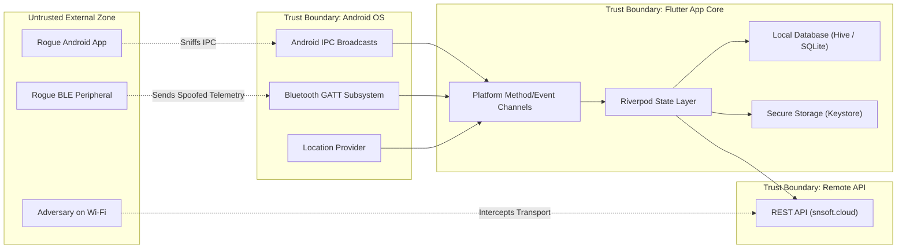

# Comprehensive Security Threat Model (STRIDE)
**Project:** Golden Feather ELD  
**Target Architecture:** Flutter Clean Architecture with Native Android / iOS Integration  
**Methodology:** STRIDE (Spoofing, Tampering, Repudiation, Information Disclosure, Denial of Service, Elevation of Privilege)  
**Date:** October 2026  

---

## 1. System Overview & Context

Golden Feather ELD is a specialized mobile electronic logging device application designed for commercial motor vehicle (CMV) drivers. It operates under strict federal regulations (FMCSA 49 CFR Part 395) mandating continuous tracking and accurate recording of driver duty status (Off-Duty, Sleeper Berth, Driving, On-Duty Not Driving, Personal Conveyance, Yard Move), vehicle engine hours, odometer readings, and GPS locations.

The application integrates with:
1. **Vehicle Hardware:** Bluetooth Low Energy (BLE) ELD ECM gateway.
2. **Device Hardware:** GPS sensors, system clock, internal storage.
3. **Carrier Cloud Backend:** Traccar REST API and raw position ingestion endpoint.

---

## 2. Security Assets Inventory

The application processes, stores, and transmits the following high-value assets:

| Asset ID | Asset Name | Description | Sensitivity Level | Regulatory Impact |
| :--- | :--- | :--- | :--- | :--- |
| **AST-01** | **HOS Compliance Records** | Historical and current duty status events, intervals, event sequence IDs, annotations. | **CRITICAL** | FMCSA non-compliance penalties, audit violations. |
| **AST-02** | **Driver Electronic Signatures** | Handwritten signatures certifying daily logs, stored as draft points and rendered PNG images. | **HIGH** | Legal repudiation, falsification of federal records. |
| **AST-03** | **Driver PII & Credentials** | Driver full name, driver's license number, state, email, user ID, `JSESSIONID` session cookie. | **HIGH** | Privacy regulations (GDPR/CCPA/State privacy laws). |
| **AST-04** | **Real-Time GPS Tracking Data** | High-frequency latitude, longitude, speed, bearing, altitude coordinates. | **HIGH** | Physical safety of driver, competitive route intelligence. |
| **AST-05** | **Vehicle Telemetry Data** | Engine hours, vehicle speed, odometer readings, VIN, ECM diagnostic codes. | **HIGH** | ELD tampering, vehicle status falsification. |
| **AST-06** | **Offline Mutation Queue** | Pending requests, duty status transitions, DVIR submissions waiting for network synchronization. | **HIGH** | Data loss, event ordering corruption. |

---

## 3. Threat Actors & Motivations

| Threat Actor ID | Profile | Motivations | Capabilities & Access |
| :--- | :--- | :--- | :--- |
| **ACT-01: Malicious / Fatigued Driver** | Authenticated commercial driver seeking to exceed maximum allowable driving hours without triggering HOS violations. | Financial gain, avoiding rest breaks, avoiding safety citations. | Physical possession of the mobile device, ability to manipulate device settings, restart app, simulate GPS, disconnect BLE, alter device clock. |
| **ACT-02: Rogue Co-Driver / Shared User** | Co-driver or subsequent driver operating the same physical tablet/phone in slip-seat fleet operations. | Convenience, curiosity, identity substitution, unapproved log alteration. | Direct physical access to the device during or after another driver's shift; access to unencrypted local app sandbox if device is unlocked. |
| **ACT-03: Malicious Local Android Application** | Co-located malicious or adware app installed on the driver's personal or company smartphone. | Data theft, location tracking, extortion, commercial surveillance. | Can register Android broadcast receivers, inspect public storage, monitor logcat (on older Android versions or via debugging). |
| **ACT-04: Rogue Bluetooth Peripheral Operator** | Nearby adversary with a BLE transmitter (e.g. at a truck stop or rest area). | Vandalism, ELD jamming, falsification of vehicle telemetry. | Transmits spoofed BLE advertising packets and GATT characteristics matching standard UART profiles. |
| **ACT-05: Network Man-in-the-Middle (MITM)** | Attacker on untrusted public Wi-Fi or compromised cellular routing. | Credential harvesting, traffic analysis, payload modification. | Intercepts cleartext or improperly validated TLS network traffic. |

---

## 4. Trust Boundaries & Entry Points

### Key Entry Points:
1. **EP-01 (Native BLE GATT):** [`BluetoothPlugin.kt`](file:///d:/Flutter%20projects/golden_feather_eld/android/app/src/main/kotlin/com/goldenfeather/eld/BluetoothPlugin.kt) receives raw byte arrays from external BLE devices on characteristic `0000ffe1-...`.
2. **EP-02 (Android Intent Receivers):** [`BootReceiver.kt`](file:///d:/Flutter%20projects/golden_feather_eld/android/app/src/main/kotlin/com/goldenfeather/eld/BootReceiver.kt) receives OS broadcast `BOOT_COMPLETED`.
3. **EP-03 (Android Location Service):** [`TrackingForegroundService.kt`](file:///d:/Flutter%20projects/golden_feather_eld/android/app/src/main/kotlin/com/goldenfeather/eld/TrackingForegroundService.kt) receives `Location` objects from Android `LocationManager`.
4. **EP-04 (HTTP Response Parser):** [`ApiClient.dart`](file:///d:/Flutter%20projects/golden_feather_eld/lib/core/network/api_client.dart) and [`LenientJsonTransformer.dart`](file:///d:/Flutter%20projects/golden_feather_eld/lib/core/network/lenient_json_transformer.dart) receive and parse JSON strings and headers from the remote server.
5. **EP-05 (Local Filesystem):** Hive boxes (`events_box`, `daily_logs_cache_box`) and SQLite files (`offline_queue.db`, `locations.db`) loaded on startup.

---

## 5. Detailed STRIDE Analysis

### 5.1. Spoofing (Identity & Telemetry)
- **T-SPOOF-01 (BLE ECM Spoofing):** An adversary transmits spoofed BLE packets mimicking an ELD adapter. Because `BluetoothPlugin.kt` does not verify peripheral identity, cryptographic certificates, or initiate pairing, the app accepts false speed and engine hour data.  
  *Existing Mitigations:* None.  
  *Residual Risk:* **HIGH**.
- **T-SPOOF-02 (Driver Identity Spoofing during Offline Sync):** A driver attempts to inject mutations into the offline queue under a different driver's account.  
  *Existing Mitigations:* Mitigated. `TraccarRemoteEventDispatcher._authorize()` strictly enforces that `ownership.driverId == sessionDriverId`. Mismatched mutations are quarantined.  
  *Residual Risk:* **LOW**.
- **T-SPOOF-03 (Location Provider Spoofing):** Driver uses an Android mock location app to simulate staying in a parking lot while actively driving.  
  *Existing Mitigations:* Native service inspects `location.isFromMockProvider`.  
  *Residual Risk:* **MEDIUM** (Advanced root/Magisk modules can bypass `isFromMockProvider`).

### 5.2. Tampering (Data & State Manipulation)
- **T-TAMP-01 (Local Database Tampering):** On a shared or rooted device, an attacker edits `offline_queue.db` or Hive files to modify recorded duty status event timestamps before synchronization.  
  *Existing Mitigations:* Standard Android application sandboxing. No cryptographic database encryption (SQLCipher/HiveAesCipher).  
  *Residual Risk:* **HIGH**.
- **T-TAMP-02 (Offline Time Tampering):** An attacker disables network connectivity, alters the system clock, and restarts the app. The app's `MonotonicTrustedTimeProvider` computes offset based on `DateTime.now().difference(restoredDeviceWall)`.  
  *Existing Mitigations:* Time drift is corrected once network connectivity is re-established. However, offline records created during the disconnected window carry the manipulated timestamp.  
  *Residual Risk:* **MEDIUM**.

### 5.3. Repudiation (Disavowing Actions)
- **T-REP-01 (Signature Repudiation):** A driver claims they did not certify a daily log containing HOS violations, arguing that the system merely copied a previously submitted PNG image.  
  *Existing Mitigations:* The server receives `{ certified: true, signatureImage: "..." }`. The system records the driver ID and timestamp, but lacks a hardware-backed digital signature (private key in Keystore signing the log SHA-256 hash).  
  *Residual Risk:* **MEDIUM**.

### 5.4. Information Disclosure (Data Leakage)
- **T-INFO-01 (Real-Time Location Broadcast Sniffing):** `TrackingForegroundService.kt` invokes `sendBroadcast(intent)` with `ACTION_LOCATION_UPDATE` without setting a target package or signature permission.  
  *Existing Mitigations:* None.  
  *Residual Risk:* **HIGH**.
- **T-INFO-02 (Cross-Driver Cache Leakage on Shared Devices):** Driver A logs out. `AuthRepositoryImpl._clearLocalData()` deletes session credentials, but leaves Hive `daily_logs_cache_box`, draft signatures (`sig_draft:*`), and `locations.db` intact on disk.  
  *Existing Mitigations:* None.  
  *Residual Risk:* **MEDIUM**.
- **T-INFO-03 (Cleartext Logcat GPS Exposure):** `TrackingForegroundService.kt` outputs real-time driver coordinates to system Logcat via `Log.i("TRACKING_SVC", ...)`.  
  *Existing Mitigations:* None.  
  *Residual Risk:* **LOW**.

### 5.5. Denial of Service (Availability & Queue Starvation)
- **T-DOS-01 (Offline Queue Poisoning):** An invalid or corrupt event in the offline queue repeatedly fails, blocking subsequent valid compliance events.  
  *Existing Mitigations:* `SQLiteOfflineQueue` routes unrecoverable errors to a dedicated `dead_letters` table (capped at 200 rows) and isolates unproven events in `quarantine`. Valid events continue processing.  
  *Residual Risk:* **LOW (Mitigated)**.

### 5.6. Elevation of Privilege (Access Control Bypasses)
- **T-ELEV-01 (Driver Accessing Fleet / Carrier Admin APIs):** A driver invokes back-office carrier endpoints (e.g. editing carrier rules, accessing other drivers' files).  
  *Existing Mitigations:* The Flutter driver app adheres to the Driver App Scope Rule and excludes administrative management code. Server-side role-based access control enforces tenant boundaries.  
  *Residual Risk:* **LOW (Mitigated on client; relies on server-side RBAC)**.

---

## 6. Threat Modeling Summary Matrix

| Threat ID | Threat Name | Category | Likelihood | Impact | Severity | Primary Defense Required |
| :--- | :--- | :--- | :--- | :--- | :--- | :--- |
| **T-INFO-01** | Location IPC Broadcast Leakage | Info Disclosure | High | High | **HIGH** | Explicit Intent / Package Binding |
| **T-SPOOF-01**| Unauthenticated BLE Connection | Spoofing | Medium | High | **HIGH** | BLE Bonding & Mutual Auth |
| **T-TAMP-01** | Plaintext Local Database Tampering | Tampering | Medium | High | **HIGH** | Database Encryption (AES-256) |
| **T-INFO-02** | Stale Cache on Shared Device | Info Disclosure | High | Medium | **MEDIUM** | Complete Logout Cache Purge |
| **T-TAMP-02** | Offline Clock Manipulation | Tampering | Medium | Medium | **MEDIUM** | Hardware Uptime Cross-Check |
| **T-REP-01**  | Electronic Signature Repudiation | Repudiation | Medium | Medium | **MEDIUM** | Hardware Digital Signatures |
| **T-INFO-03** | Android Logcat Coordinate Leak | Info Disclosure | High | Low | **LOW** | Strip Production Logs |

---

## 7. Residual Risks & Architectural Recommendations

1. **Operating System Boundary Hardening:** The mobile application cannot treat the Android OS environment as intrinsically trusted. All inter-process communication (IPC) must be sealed using explicit package identifiers or signature-level permissions.
2. **Cryptographic Sealing of Local State:** All compliance databases must be encrypted at rest. Keys should be dynamically managed via `FlutterSecureStorage` backed by Android Keystore and iOS Keychain.
3. **Zero-Trust Hardware Communication:** Bluetooth Low Energy communication with vehicle ECM adapters must enforce application-layer encryption or standard BLE Security Mode 1 Level 4 (authenticated LE Secure Connections with Diffie-Hellman key exchange).
