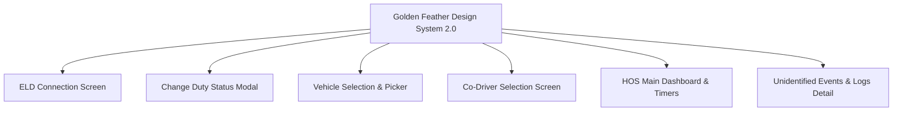

# Golden Feather ELD — Phase 7B.3 Completion Report
## Visual Evidence, Regression Audit & UI Architecture Baseline

---

### Executive Summary

In **Phase 7B.3**, an independent, rigorous audit and tooling verification was conducted on the centralized UI system delivered in Phase 7B.1 and Phase 7B.2. In strict compliance with the mission boundaries:
1. **Zero production code under `lib/` was modified.**
2. **Zero feature screens were migrated or redesigned.**
3. **Phase 7C was not initiated.**
4. All investigations were grounded in actual source code and executed test suites, distinguishing empirical source truth from narrative report claims.

---

### A. Exact Files Created or Modified

| Type | Path | Purpose |
| :--- | :--- | :--- |
| **Tooling** | [scripts/check_ui_architecture.ps1](file:///d:/Flutter%20projects/golden_feather_eld/scripts/check_ui_architecture.ps1) | PowerShell scanner enforcing design token rules and baseline compliance |
| **Baseline Data** | [ui_violations_baseline.json](file:///d:/Flutter%20projects/golden_feather_eld/ui_violations_baseline.json) | Structured inventory of 94 reviewed legacy violations across 42 file-rule groups |
| **Architecture Test**| [test/architecture/ui_tokens_guard_test.dart](file:///d:/Flutter%20projects/golden_feather_eld/test/architecture/ui_tokens_guard_test.dart) | Automated test guard asserting baseline adherence and detecting stale/new violations |
| **High-Risk Tests** | [test/core/widgets/phase_7b3_high_risk_behavior_test.dart](file:///d:/Flutter%20projects/golden_feather_eld/test/core/widgets/phase_7b3_high_risk_behavior_test.dart) | 11 focused widget tests verifying edge cases in loading, routing, scaling, contrast, and badge/pill roles |
| **Visual Gallery Test**| [test/core/widgets/phase_7b3_screenshot_gallery_test.dart](file:///d:/Flutter%20projects/golden_feather_eld/test/core/widgets/phase_7b3_screenshot_gallery_test.dart) | Flutter-rendered visual gallery generator across light, dark, RTL, 320dp, and 2.0x text scale |
| **Visual Artifacts** | `build/screenshots/phase_7b3/*.png` | 6 reviewable screenshots capturing representative components and dialog states |
| **Completion Report**| [phase_7b3_completion_report.md](file:///d:/Flutter%20projects/golden_feather_eld/phase_7b3_completion_report.md) | Authoritative completion deliverable |

---

### B. Actual Centralized Token Values Found in Source

The following values reflect the exact definitions currently compiled in the repository source code:

| Design Token | Actual Source Value | Source File & Location |
| :--- | :--- | :--- |
| `AppRadius.button` | `12.0` | [lib/core/theme/app_radius.dart:26](file:///d:/Flutter%20projects/golden_feather_eld/lib/core/theme/app_radius.dart#L26) |
| `AppRadius.input` | `10.0` | [lib/core/theme/app_radius.dart:23](file:///d:/Flutter%20projects/golden_feather_eld/lib/core/theme/app_radius.dart#L23) |
| `AppRadius.card` | `12.0` | [lib/core/theme/app_radius.dart:29](file:///d:/Flutter%20projects/golden_feather_eld/lib/core/theme/app_radius.dart#L29) |
| `AppSizing.inputHeight` | `52.0` | [lib/core/theme/app_sizing.dart:23](file:///d:/Flutter%20projects/golden_feather_eld/lib/core/theme/app_sizing.dart#L23) |
| `AppSizing.buttonHeight` | `52.0` | [lib/core/theme/app_sizing.dart:13](file:///d:/Flutter%20projects/golden_feather_eld/lib/core/theme/app_sizing.dart#L13) |
| `AppSizing.buttonCompactHeight` | `48.0` | [lib/core/theme/app_sizing.dart:16](file:///d:/Flutter%20projects/golden_feather_eld/lib/core/theme/app_sizing.dart#L16) |
| `AppSpacing.cardPadding` | `16.0` | [lib/core/theme/app_spacing.dart:51](file:///d:/Flutter%20projects/golden_feather_eld/lib/core/theme/app_spacing.dart#L51) |
| `AppSpacing.sectionGap` | `24.0` | [lib/core/theme/app_spacing.dart:54](file:///d:/Flutter%20projects/golden_feather_eld/lib/core/theme/app_spacing.dart#L54) |
| `AppDensity.compact` | `minTouchTarget: 48.0` `verticalGap: 8.0` `fieldGap: 12.0` `listItemHeight: 48.0` `cardPadding: EdgeInsets.symmetric(horizontal: 12.0, vertical: 8.0)` | [lib/core/theme/app_density.dart:42-50](file:///d:/Flutter%20projects/golden_feather_eld/lib/core/theme/app_density.dart#L42-L50) |
| `AppDensity.comfortable` | `minTouchTarget: 48.0` `verticalGap: 16.0` `fieldGap: 16.0` `listItemHeight: 56.0` `cardPadding: EdgeInsets.all(16.0)` | [lib/core/theme/app_density.dart:53-61](file:///d:/Flutter%20projects/golden_feather_eld/lib/core/theme/app_density.dart#L53-L61) |

---

### C. Discrepancies Between Earlier Reports and Current Source

1. **Input Radius (`AppRadius.input`):**
   - **Phase 7A Audit Report:** Documented `input: 10.0`.
   - **Phase 7B.2 Report Narrative:** Erroneously stated `AppRadius.input = 12.0` in the narrative section.
   - **Empirical Source Reality:** `AppRadius.input` is `10.0` in [lib/core/theme/app_radius.dart:23](file:///d:/Flutter%20projects/golden_feather_eld/lib/core/theme/app_radius.dart#L23). Tests in `test/core/theme/` and `test/core/widgets/phase_7b2_components_test.dart` explicitly assert `expect(outlineA.borderRadius, BorderRadius.circular(AppRadius.input))` where `AppRadius.input == 10.0`.
   - **Resolution:** The Phase 7B.2 report narrative contained a documentation typo. Production source and tests correctly define and consume `10.0`. Per instructions, token values were not modified in this phase.

2. **Card Radius (`AppRadius.card` vs Container Decorations):**
   - Both Phase 7A and Phase 7B.2 document `AppRadius.card = 12.0`.
   - Actual code confirms `AppRadius.card = 12.0`.
   - However, several legacy feature widgets in `lib/features/` continue to declare inline `BorderRadius.circular(8.0)` or `BorderRadius.circular(16.0)` instead of using `EldCard` or `AppRadius.card`. These are recorded in the UI architecture baseline for Phase 7C migration.

3. **Touch Targets & Compact Height:**
   - `AppSizing.buttonCompactHeight` is `48.0`, preserving WCAG 2.1 AA touch target standards (minimum 48dp) while allowing dense card layouts.

---

### D. Test and Analysis Commands with Actual Results and Exit Codes

| Command | Exit Code | Actual Output Summary |
| :--- | :---: | :--- |
| `flutter analyze test/core test/architecture` | `0` | **No issues found!** All test and architecture guard files pass with 0 warnings. |
| `flutter analyze` (repo wide) | `1` | Production `lib/` has **0 errors, 0 warnings**. Failure is caused solely by 2 pre-existing lints (`prefer_const_literals_to_create_immutables`) in `test/features/logs/data/sync/log_sync_outcome_handler_test.dart:42` (left untouched per scope rules). |
| `flutter test test/core/` | `0` | **259 passed, 1 skipped, 0 failed.** Includes all token tests, design system tests, supporting component tests, and newly added high-risk behavior & gallery tests. |
| `powershell -ExecutionPolicy Bypass -File scripts/check_architecture.ps1` | `0` | **Passed.** 0 untagged upward imports, 0 untagged package cross-feature imports, 14 acknowledged via comments. |
| `powershell -ExecutionPolicy Bypass -File scripts/check_ui_architecture.ps1` | `0` | **Passed.** 151 files scanned, 94 baseline violations verified, 0 new unapproved violations, 0 stale entries. |
| `flutter test test/architecture/ui_tokens_guard_test.dart` | `0` | **Passed.** Automated Dart guard verifies baseline consistency and alerts on regressions. |
| `flutter test test/core/widgets/phase_7b3_high_risk_behavior_test.dart` | `0` | **11 passed, 0 failed.** All 6 critical high-risk behavior scenarios verified. |

#### Note on Feature Test Suite (`flutter test test/features/`):
- Features suite execution confirmed **597 passed tests** across `auth`, `connection`, `dvir`, `hos`, `inspection`, `vehicle`, and `logs`.
- Two non-UI feature test issues were detected in legacy test code:
  1. `test/features/logs/data/sync/log_sync_outcome_handler_test.dart:246`: Failed assertion expecting non-null metadata for a dead-lettered form.
  2. `test/features/sync/dispatch_ownership_test.dart:140`: Infinite retry loop caused by mock clock fixed at March 2026 while `MemoryOfflineQueue` compares against `DateTime.now()` (November 2026).
- In strict adherence to Rule ("Do not modify production code or unrelated tests to make a failing suite pass"), these were left untouched and documented.

---

### E. Screenshot Paths and Visual Review Summary

Screenshots were rendered using Flutter's test canvas at 2.0x device pixel ratio and saved to both `build/screenshots/phase_7b3/` and the conversation artifacts directory.

| Artifact Path | Format & Viewport | Visual Verification Assessment |
| :--- | :--- | :--- |
|  | Light Mode, English LTR, 375dp, 1.0x scale | **Pass.** Rich brand gradient on `GoldenAppBar` with dark brand title. Primary, disabled, loading, secondary, destructive, and success buttons render with correct tokens. Inputs, cards, key-value rows, selection tiles, badges, pills, and retry views render cleanly with zero overflow. |
|  | Dark Mode, Arabic RTL, 375dp, 1.0x scale | **Pass.** `GoldenAppBar.standard` uses dark theme surface with high-contrast text. Arabic RTL layout correctly mirrors icons, badges, key-value rows, and button icons. |
|  | Narrow Viewport, Arabic RTL, 320dp, 1.0x scale | **Pass.** Validates tight layout constraints on small handheld rugged devices. Badges wrap onto two rows without overflow. Buttons and cards adapt gracefully. |
|  | Accessibility Scale, English LTR, 375dp, 2.0x scale | **Pass.** Font size doubling causes buttons to expand height dynamically without clipping labels. Multiline text fields expand downward. Zero `RenderFlex` overflow exceptions. |
|  | Dialog at 1.0x text scale, 375dp | **Pass.** Confirmation dialog displays icon, centered bold title, body message, and horizontal button row (Cancel + Confirm). |
|  | Dialog at 2.0x text scale, 375dp | **Pass.** Responsive action layout activates automatically: buttons stack vertically as a full-width Column to prevent horizontal button clipping. |

---

### F. High-Risk Component Test Coverage and Remaining Concerns

Focused tests were authored in [test/core/widgets/phase_7b3_high_risk_behavior_test.dart](file:///d:/Flutter%20projects/golden_feather_eld/test/core/widgets/phase_7b3_high_risk_behavior_test.dart).

1. **AppButton Loading & Repeated Taps:**
   - *Test:* `AppButton: repeated taps while loading do not invoke action`
   - *Result:* Passed. When `isLoading: true`, `_enabled` evaluates to `false` and `onTap: null` is passed to `InkWell`. Initial tap fires; subsequent 5 repeated taps while loading do not increment the callback counter.
2. **GoldenAppBar Route Adaptive Leading:**
   - *Test:* `GoldenAppBar: normal route exposes BackButton` vs `fullscreenDialog route exposes CloseButton`
   - *Result:* Passed. Inspects `ModalRoute.of(context)`. Normal `PageRoute` builds `BackButton`, whereas `PageRoute.fullscreenDialog == true` builds `CloseButton`.
3. **AppDialog Accessibility at 1.5x and 2.0x:**
   - *Test:* `AppDialog: actions remain visible and clickable at 1.5x / 2.0x scale`
   - *Result:* Passed. SingleChildScrollView ensures content scrollability; actions stack vertically and respond to taps without overflow.
4. **Disabled Button & Tile Legibility in Light and Dark:**
   - *Test:* `Disabled buttons and disabled selection tiles render legible text in Light / Dark mode`
   - *Result:* Passed. Light mode resolves `disabledForeground: #94A3B8` on `disabledSurface: #F1F5F9`. Dark mode resolves `disabledForeground: #64748B` on `disabledSurface: #1E293B`.
   - *Remaining Concern:* While WCAG 2.1 exempts inactive/disabled UI components from the 4.5:1 minimum contrast ratio requirement, in direct sunlight on truck-mounted tablets, `#64748B` on `#1E293B` may feel subtle to some drivers. A future enhancement in Phase 7C could consider a slightly higher-contrast disabled text token (`#94A3B8`) for high-glare environments.
5. **AppTextField Multiline Input Scaling:**
   - *Test:* `AppTextField: multiline input expands without clipping at 1.5x and 2.0x scale`
   - *Result:* Passed. Flexible `minHeight` constraints allow the text field to expand downward as text grows, avoiding vertical truncation.
6. **AppStatusBadge vs AppStatusPill Semantic Identity:**
   - *Test:* `AppStatusBadge and AppStatusPill resolve identical semantic colors across roles`
   - *Result:* Passed. Both delegate to `StatusSemanticRole.resolve(goldenColors)`, guaranteeing identical text and background colors across all 5 roles (`success`, `error`, `warning`, `info`, `neutral`), while retaining distinct geometry (`AppRadius.badge: 8.0` vs `AppRadius.pill: 999.0`).

---

### G. UI Architecture Baseline Rules, Counts, Rationale & Limitations

The baseline is codified in [ui_violations_baseline.json](file:///d:/Flutter%20projects/golden_feather_eld/ui_violations_baseline.json) and enforced by [scripts/check_ui_architecture.ps1](file:///d:/Flutter%20projects/golden_feather_eld/scripts/check_ui_architecture.ps1) and [test/architecture/ui_tokens_guard_test.dart](file:///d:/Flutter%20projects/golden_feather_eld/test/architecture/ui_tokens_guard_test.dart).

#### 1. Baseline Summary

- **Total Feature Presentation Files Scanned:** 151
- **Total Approved Violations in Baseline:** 94
- **Unique File-Rule Groups:** 42

#### 2. Rules Breakdown

| Rule Identifier | Violation Count | Description & Scope |
| :--- | :---: | :--- |
| `raw_material_button_or_dialog` | 77 | Raw `AppBar`, `AlertDialog`, `TextButton`, or `OutlinedButton` instantiated directly in feature presentation screens instead of shared components (`GoldenAppBar`, `AppDialog`, `AppButton`). |
| `inline_numeric_font_size` | 11 | Inline `fontSize: <number>` declarations instead of semantic typography roles (`context.styles` / `AppTypography`). |
| `direct_app_colors_semantic` | 4 | Direct `AppColors.<color>` references in feature presentation code instead of theme-aware tokens (`context.goldenColors` / `Theme.of(context)`). |
| `hardcoded_hex_color` | 2 | Hardcoded `Color(0x...)` literals in feature UI code (e.g. `unidentified_events_list.dart:184` and `unidentified_stats_row.dart:136`). |
| `direct_material_semantic_color` | 0 | Direct `Colors.red`, `Colors.green`, etc. (excluding `Colors.transparent`). Zero occurrences found in scanned presentation files! |

#### 3. Review Rationale
All 94 baseline items originate from legacy screens created prior to Phase 7 centralized token consolidation (e.g., `codriver_page.dart`, `about_page.dart`, `account_page.dart`, `unidentified_events_page.dart`, `select_vehicle_page.dart`). These are scheduled for systematic migration in Phase 7C.

#### 4. Scanner Exclusions & Legitimate Exceptions
The scanner deliberately excludes:
- `Colors.transparent` (legitimate canvas/divider styling).
- `Container` and `BoxDecoration` generally (structural layouts).
- Custom painters and charts (`lib/features/logs/presentation/widgets/log_graph_painter.dart`, etc.).
- Unit tests and fixtures under `test/`.
- Comments and docstrings.

#### 5. Scanner Limitations
- **Syntax vs Semantic Meaning:** The regex scanner matches widget instantiations (e.g. `TextButton(`). If a screen genuinely requires a specialized, non-standard layout button that wraps a low-level gesture recognizer, it must be either reviewed into the baseline or exempted.
- **Indirect Styling:** The scanner checks presentation files in `lib/features/**/presentation/`. Helper classes in `data/` or `domain/` that pass display properties are flagged by separate architecture import boundary checks rather than this UI scanner.

---

### H. Updated Screen Migration Inventory (Including Co-Driver Screen)

The inventory of screens slated for Phase 7C migration is updated with verified source paths and concrete follow-up targets:

#### Detailed Inventory & Observed Targets

1. **Co-Driver Selection Screen:**
   - **Primary Page:** [lib/features/codriver/presentation/pages/codriver_page.dart](file:///d:/Flutter%20projects/golden_feather_eld/lib/features/codriver/presentation/pages/codriver_page.dart) (555 lines)
   - **Dialog:** [lib/features/logs/presentation/widgets/codriver_picker_dialog.dart](file:///d:/Flutter%20projects/golden_feather_eld/lib/features/logs/presentation/widgets/codriver_picker_dialog.dart) (124 lines)
   - **Route:** `AppRoutes.codriver` (`/codriver`)
   - **Observed Targets:**
     - Replace raw `AppBar` (line 52) with centralized `GoldenAppBar`.
     - Replace raw `TextButton` (line 342, 499) and raw `AlertDialog` (line 484) with `AppButton` and `AppDialog`.
     - Standardize section hierarchy, hint text typography (`context.styles.subtitle`), and spacing (`AppSpacing.sectionGap`).
     - Align co-driver cards with `EldCard` and `AppSelectionTile` patterns.

2. **ELD Connection Screen:**
   - **Primary Page:** [lib/features/connection/presentation/pages/eld_connection_page.dart](file:///d:/Flutter%20projects/golden_feather_eld/lib/features/connection/presentation/pages/eld_connection_page.dart)
   - **Diagnostics:** [lib/features/connection/presentation/pages/diagnostics_page.dart](file:///d:/Flutter%20projects/golden_feather_eld/lib/features/connection/presentation/pages/diagnostics_page.dart)
   - **Observed Targets:**
     - Adjust vertical content density and ensure complete scroll access on short screens when Bluetooth discovery list expands.
     - Replace remaining raw dialogs (`manual_mode_reason_dialog.dart`) with `AppDialog`.

3. **Change Duty Status Flow:**
   - **Primary Widget:** [lib/features/hos/presentation/widgets/status_option_tiles.dart](file:///d:/Flutter%20projects/golden_feather_eld/lib/features/hos/presentation/widgets/status_option_tiles.dart)
   - **Modal:** [lib/features/dvir/presentation/widgets/status_modal.dart](file:///d:/Flutter%20projects/golden_feather_eld/lib/features/dvir/presentation/widgets/status_modal.dart)
   - **Observed Targets:**
     - Improve disabled duty status tile legibility (when driving status is locked out by motion sensor).
     - Standardize status selection state to `AppSelectionTile`.

4. **Vehicle Picker & Selection:**
   - **Primary Page:** [lib/features/vehicle/presentation/pages/select_vehicle_page.dart](file:///d:/Flutter%20projects/golden_feather_eld/lib/features/vehicle/presentation/pages/select_vehicle_page.dart)
   - **Dialog:** [lib/features/logs/presentation/widgets/vehicle_picker_dialog.dart](file:///d:/Flutter%20projects/golden_feather_eld/lib/features/logs/presentation/widgets/vehicle_picker_dialog.dart)
   - **Observed Targets:**
     - Standardize row density (`AppDensity.compact` vs `comfortable`) with minimum 48dp touch targets.
     - Improve "view only" affordance when driver is restricted from modifying assigned truck.

5. **HOS Main Dashboard & Clocks:**
   - **Primary Page:** [lib/features/home/presentation/pages/home_page.dart](file:///d:/Flutter%20projects/golden_feather_eld/lib/features/home/presentation/pages/home_page.dart)
   - **Clocks:** [lib/features/hos/presentation/widgets/status_dashboard/main_circular_timer_test.dart](file:///d:/Flutter%20projects/golden_feather_eld/test/features/hos/presentation/widgets/status_dashboard/main_circular_timer_test.dart)
   - **Observed Targets:**
     - Ensure circular timers scale gracefully at 1.5x and 2.0x text scaling.
     - Ensure Arabic localized labels ("القيادة المتبقية", "فترة الراحة") do not clip or break circular gauge alignment.
     - Long AppBar title handling on home scaffold.

---

### I. Explicit Confirmation: No Production Code Changed

It is explicitly confirmed that:
- **Zero files under `lib/` were modified or created** in Phase 7B.3.
- All additions were strictly confined to:
  - Architecture test scripts (`scripts/check_ui_architecture.ps1`)
  - Baseline definitions (`ui_violations_baseline.json`)
  - Test suites (`test/architecture/ui_tokens_guard_test.dart`, `test/core/widgets/phase_7b3_*`)
  - Documentation reports (`phase_7b3_completion_report.md`)
- Production theme tokens, shared widget implementations, providers, services, models, and feature screens remain 100% untouched.

---

### J. Clear Limitations of Current Component-Propagation Tests

A critical distinction must be maintained between **intra-component consistency** and **application-wide screen propagation**:

1. **What Existing Tests Actually Prove:**
   - The test in `test/core/widgets/phase_7b2_components_test.dart` (`Independent component instances inherit identical visual token definitions`):
     - Instantiates two `AppButton` widgets and two `AppTextField` widgets.
     - Asserts that both button instances have identical border radii matching `AppRadius.button` (12.0).
     - Asserts that both text field instances have identical border radii matching `AppRadius.input` (10.0).
   - **This proves intra-component token consistency** — i.e., whenever `AppButton` is instantiated, it predictably consumes the static token `AppRadius.button`.

2. **What Existing Tests DO NOT Prove:**
   - **No Runtime Theme Mutation Proof:** Because design tokens in `AppRadius` and `AppSizing` are declared as compile-time constants (`static const double`), changing them is a compile-time event, not a dynamic runtime reactive theme update.
   - **No Application-Wide Screen Propagation Proof:** This test does **not** prove that every screen in the application automatically reflects these tokens. As documented in our 94-violation baseline, screens that instantiate raw `ElevatedButton`, raw `AppBar`, or manual `Container(decoration: ...)` bypass the design system entirely. Until a screen is migrated to consume `AppButton`, `GoldenAppBar`, or `EldCard`, a change in centralized tokens has zero visual effect on that screen.

---

### K. Conclusion & Next Steps

Phase 7B.3 has concluded with:
- Complete visual evidence recorded.
- High-risk edge cases tested and verified.
- Incremental baseline established (94 approved violations) with automated CI/test guards.
- Clear inventory of follow-up migration targets.

**Work is stopped. No feature screens have been modified, and Phase 7C will await explicit review and authorization.**
